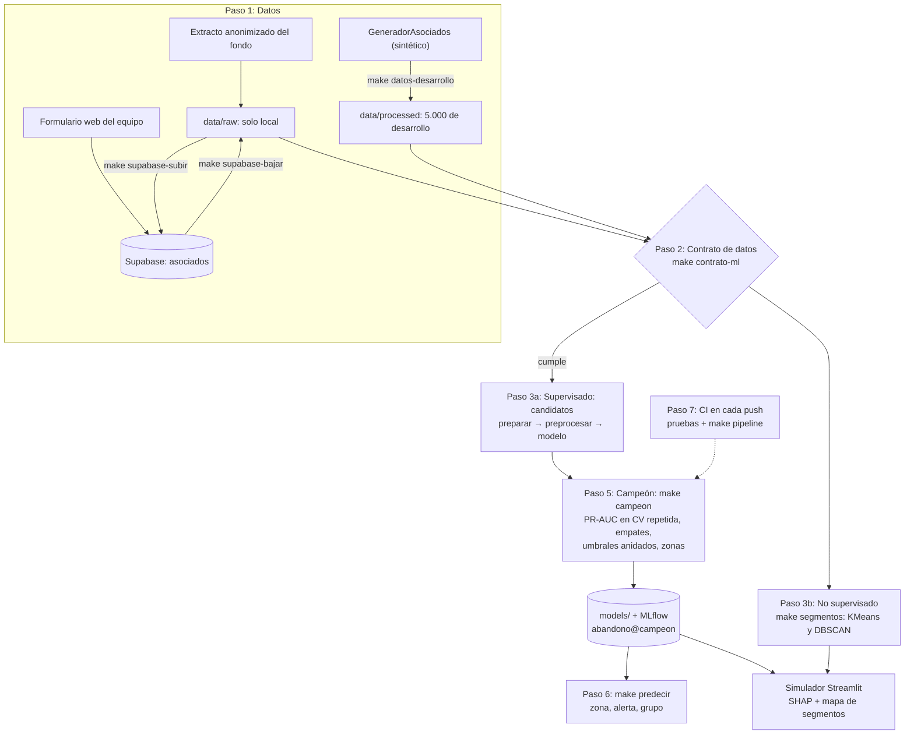

# Proyecto I — Especialización en Ciencia de Datos

[](https://github.com/juanccadavid/proyecto-ml/actions/workflows/ci.yml)

**Predicción de abandono de asociados de un fondo de empleados**, de punta a punta y con datos sintéticos.

**Problema:** anticipar qué asociados de un fondo de empleados se van a retirar en los próximos 3 meses, para
contactarlos a tiempo. Retener a un asociado cuesta menos que reemplazarlo, y el retiro es raro (pocos de cada
100), así que el modelo tiene que encontrar a los pocos que se van sin llenar de falsas alarmas al equipo.

**Cómo:** contrato de datos → anonimización → foto del asociado en t0 (sin fuga de información) → pipeline de
scikit-learn → campeón por PR-AUC en validación cruzada repetida, con umbrales medidos en validación anidada y
una prueba de estrés temporal → MLflow → predicción, simulador en Streamlit con SHAP y segmentos (KMeans, DBSCAN).

> **Estado (nov-2026): todo el sistema corre y está probado, pero solo con DATOS SINTÉTICOS.** El extracto real
> del fondo no ha llegado. Las métricas de este README salen del generador (`generador.py`): prueban que el
> sistema funciona, **no** cómo le irá al modelo con el fondo. Para datos reales hacen falta el extracto
> anonimizado y, en el `.env`, `ORIGEN_DATOS=real_anonimizado`, `FECHA_CORTE` y `DATOS_ASOCIADOS` (ver
> "Datos sintéticos y datos reales"), además de confirmar la temporalidad con el fondo.

> **¿Nuevo en el proyecto?** Empieza por [`docs/guia_comandos.txt`](docs/guia_comandos.txt): Git, uv, Make,
> imports, contratos, pipeline y generador de datos, con los comandos de este proyecto.

## Tecnologías

| Para qué | Con qué |
|---|---|
| Datos y contrato | pandas, Polars (ingesta), pandera (contrato de datos en tres niveles), Supabase (tabla + formulario web) |
| Modelos | scikit-learn (`Pipeline`, `ColumnTransformer`), imbalanced-learn, Optuna; PyCaret (opcional, para comparar) |
| Evaluación y explicación | PR-AUC, MCC, Brier, validación anidada, prueba t de Nadeau y Bengio, SHAP |
| Seguimiento | MLflow (experimentos, versión de los datos por huella, modelo registrado con alias) |
| App | Streamlit (simulador con SHAP y mapa de segmentos), Plotly |
| Calidad y entrega | uv (`uv.lock`), Ruff, mypy, pytest, pre-commit (gitleaks), GitHub Actions, Docker Compose |

## Instalación

- [uv](https://docs.astral.sh/uv/) (gestiona Python 3.12 y dependencias)
- Git. Opcionales: Docker Desktop, `make` (en Windows: Git Bash + `winget install ezwinports.make`)

```bash
git clone <url-del-repo> && cd <repo>
make setup        # uv sync (versiones exactas de uv.lock) + .env desde .env.example + hooks de pre-commit
```

**Windows y la salida redirigida.** Al redirigir la salida (`> log.txt` o a una tubería), Python en Windows
escribe con la página de códigos del sistema (cp1252) y falla con caracteres como `−`. `make` ya activa el modo
UTF-8 de Python (`PYTHONUTF8=1`). Sin `make`: `$env:PYTHONUTF8 = "1"` en PowerShell o `set PYTHONUTF8=1` en
CMD. Para leer bien esa salida en la consola de PowerShell 5.1:
`[Console]::OutputEncoding = [Text.UTF8Encoding]::new()`.

## Inicio rápido

Después de `make setup` (y de ajustar el `.env` si hace falta):

```bash
make demo                    # genera el dataset sintético y entrena con él (MLflow)
make train                   # entrena con DATA_PATH del .env (o: make train DATA=... ARGS="--pca 0.95")
make train ARGS="--clip-outliers iqr --clip-columns salario"  # además recorta atípicos de salario
make train ARGS="--sin-limpieza"  # sin la limpieza de cleaning.py, para comparar en MLflow
make mlflow-ui               # http://localhost:5000
make app                     # http://localhost:8501
make campeon                 # elige el modelo campeón, su umbral y zonas (MLflow: abandono@campeon)
make simulador               # http://localhost:8501: mueve las variables y mira si el asociado se retira
make pipeline                # todo el flujo: campeón, predicción, segmentos, validación cruzada, regresión
make tipos                   # mypy sobre src/proyecto_ml (también en el CI)
make check                   # lint + tipos + pruebas, antes de abrir un PR
```

**Pruebas** (`tests/`, pytest): `make test` corre todas (unas 310, unos 2-3 minutos). Cubren contrato de datos,
anonimización y PII, la foto y la fuga de información, el pipeline, el campeón y sus umbrales, la validación
temporal, la predicción, MLflow, el simulador (Streamlit `AppTest`) y los scripts. Para una sola:
`uv run pytest -q tests/test_campeon.py`.

`make` (sin argumentos) lista todos los objetivos. Sin `make`, cada objetivo del `Makefile` muestra
el comando `uv run ...` equivalente.

### Estructura frente a la plantilla del curso

| Plantilla | Aquí | Nota |
|---|---|---|
| `README.md`, `Makefile`, `pyproject.toml` | ✅ los mismos | `make` sin argumentos lista los comandos; dependencias con uv (`uv.lock`) |
| `.github/workflows/ci.yml` | ✅ | en cada push: lint + pruebas y, si pasan, `make pipeline` (ver abajo) |
| `notebooks/` | `sesiones/` | los notebooks de EDA y la bitácora del equipo |
| `src/<paquete>/config.py`, `data.py`, `features.py`, `train.py` | ✅ `src/proyecto_ml/` | |
| `model.py` | `models.py` | el catálogo de modelos; el abandono los arma en `abandono.armar_pipeline` |
| `predict.py` | ✅ `predict.py` | `make predecir DATA=...`: filas crudas de los activos → puntaje, zona, alerta y grupo |
| `app/` (Streamlit o FastAPI) | `streamlit_app.py` + `src/proyecto_ml/app_abandono.py` | Streamlit Cloud abre `streamlit_app.py` en la raíz |
| `tests/` | ✅ | pytest, con las pruebas del contrato en `tests/data/` |
| `models/` | ✅ gitignored | solo el campeón; el CI lo deja como artefacto |

### Integración continua: cada push deja el código ejecutado

[`.github/workflows/ci.yml`](.github/workflows/ci.yml) corre en **cada push, en cualquier rama** (y con el botón
*Run workflow* de la pestaña Actions):

1. **calidad**: `ruff` (lint y formato) y todas las pruebas, con las versiones exactas de `uv.lock`.
2. **ejecutar** (si la anterior pasa): `make pipeline`, que corre en orden `campeon`, `predecir`, `segmentos`,
   `validacion` y `regresion`, con un MLflow local del runner.
   - En la pestaña *Summary* de la corrida aparece el resumen del campeón: PR-AUC, recall, MCC y las zonas.
   - Las figuras, las métricas y el campeón quedan en el artefacto **resultados** (14 días).

Todo corre con datos generados (semilla fija): el extracto real nunca va a GitHub. Si haces otro push a la
misma rama mientras corre, se cancela la corrida vieja. Lo mismo se corre en local con `make pipeline`.

### Componentes Hugging Face (opcional)

```bash
uv sync --extra hf           # TabPFN + transformers (descarga torch, ~2 GB)
uv run python -m proyecto_ml.train --tabpfn
```

TabPFN: recomendado hasta ~50k filas; la licencia de la versión 2.5 **no permite uso comercial**;
en CPU es lento con miles de filas (usar Colab con GPU).

### Docker

```bash
docker compose up --build                            # simulador :8501 + servidor MLflow :5000
make docker-campeon                                  # elige el campeón dentro de Docker (ARGS=... como make campeon)
make down                                            # apaga todo (MLflow conserva sus datos en su volumen)
```

| Servicio | Qué hace | Escribe |
|---|---|---|
| `app` | El simulador (`app_abandono.py`) con el campeón de `models/`; sin campeón, lo elige al abrir con sintéticos | nada: `models/` y `data/` en solo lectura |
| `mlflow` | Servidor de MLflow; guarda experimentos y artefactos (los sirve por HTTP a los otros contenedores) | su volumen `mlflow_data` |
| `campeon` | Perfil `pipeline`, a pedido: `scripts/elegir_campeon.py` registrando en ese MLflow | `models/` y `reports/` |

Todos corren como `appuser` (uid 1000), sin root. La imagen no contiene datos ni modelos (`.dockerignore`): se
montan como volúmenes. En Linux, `models/` y `reports/` deben ser de ese uid para que `campeon` escriba
(`sudo chown -R 1000 models reports`). Si ya tenías el volumen de MLflow de una versión anterior (creado por
root), recréalo una vez: `docker compose down -v` (borra los experimentos guardados en Docker).

**Qué está verificado:** el CI (trabajo `docker`) valida el `docker-compose.yml`, construye la imagen, corre
`campeon` con MLflow en su contenedor, levanta `app` con ese campeón y espera su *healthcheck*. **No verificado en
el equipo de desarrollo** (no tiene Docker): Docker Desktop en Windows y abrir el simulador desde el navegador.

## Resultados

Las métricas versionadas anteriores correspondían al contrato de 74 columnas y dejaron de ser comparables. Tras
la migración al esquema definitivo, `make campeon` vuelve a calcularlas con 5.000 asociados sintéticos. Esas cifras
solo verifican el funcionamiento del pipeline; no describen al fondo ni sustituyen una evaluación temporal real.

Solo habrá un corte real y `#RETIROS` cuenta retiros acumulados durante la permanencia. No es la etiqueta de los
próximos tres meses; por ello el proyecto bloquea el entrenamiento supervisado del abandono con ese extracto. Lo
que no necesita etiqueta sí corre con él (`make real`): la segmentación, la regresión del salario y la predicción
con el campeón entrenado con sintéticos, que hablan los mismos campos y códigos que el extracto. Ver
[docs/datos_reales.md](docs/datos_reales.md).

## Arquitectura

### Estructura

```
├── src/proyecto_ml/      Código fuente (paquete instalable)
│   ├── config.py         Rutas y variables de entorno
│   ├── data.py           Carga, X/y y particiones (estratificada, temporal, por grupos)
│   ├── features.py       Imputación, escalado, codificación, binning, PCA, RFE (ColumnTransformer)
│   ├── models.py         Logística, Random Forest, HistGB, TabPFN (opcional)
│   ├── evaluate.py       PR-AUC, ROC-AUC, MCC, Kappa, recall@10 %, F1, importancia de variables
│   ├── train.py          Entrenamiento + MLflow + exportación del mejor modelo
│   ├── abandono.py       Modelos de abandono: supervisados (Ridge, logística, bagging, boosting) y KMeans
│   ├── busqueda_optuna.py  Optuna para afinar Random Forest y HistGB (make optuna)
│   ├── tecnicas.py       Compara técnicas de preprocesamiento y feature engineering (make tecnicas)
│   ├── correlacion.py    Correlación entre variables y con el objetivo (Spearman, V de Cramér)
│   ├── contrato.py       Contrato de datos (pandera, 3 niveles) + SQL de Supabase + campos del formulario
│   ├── generador.py      GeneradorAsociados: asociados ficticios con el esquema real
│   ├── anonymize.py      Hash con sal, eliminación de PII, agrupación en rangos
│   ├── synthetic.py      Generador sintético genérico (make demo)
│   ├── app.py            Demo Streamlit
│   ├── campeon.py        Modelo campeón: PR-AUC en CV repetida, umbrales, zonas, guardar/cargar (make campeon)
│   ├── campeon_figuras.py  Figuras del campeón: umbrales, matriz de confusión, ROC, calibración
│   ├── datos_campeon.py  Datos de entrada del campeón y de los exploratorios, según el origen y el contrato
│   ├── explicar.py       SHAP: por qué el modelo le dio a cada asociado su puntaje
│   ├── validacion.py     Escenarios, partición temporal y KFold / Stratified / TimeSeriesSplit
│   ├── regresion.py      Regresión de ejemplo: el salario con MAE, MSE, RMSE y R² (make regresion)
│   ├── segmentacion.py   No supervisado: KMeans y DBSCAN + mapa interactivo de segmentos (make segmentos)
│   ├── predict.py        Predicción con el campeón guardado: zona, alerta y grupo (make predecir)
│   ├── registro.py       Registro en MLflow (experimento abandono, alias campeon)
│   └── app_abandono.py   Simulador Streamlit del abandono con el campeón (make simulador)
├── scripts/              Ingesta, anonimización, generadores, contrato, modelo de abandono
├── streamlit_app.py      Entrada de Streamlit Community Cloud (abre el simulador)
├── .github/workflows/    ci.yml (lint, mypy, pruebas, pre-commit, Docker y make pipeline en cada push) y formulario.yml
├── contratos/            Contratos de datos (YAML)
├── supabase/             SQL de la tabla y migraciones
├── web/                  Formulario para enviar asociados a Supabase
├── docs/                 Metodología, privacidad, contrato, MLflow, datos reales, licencia y guía de comandos
├── sesiones/             Notebooks (EDA) y bitácora del equipo
├── tests/                Pruebas unitarias e integración (pytest); tests/data: reglas del contrato
├── reports/              Métricas y figuras livianas (qué se versiona: reports/README.md)
├── data/                 Datos locales — NO van a Git
└── models/               Solo el campeón (y best_model de make train) — NO van a Git
```

### Flujo del proyecto

Del dato crudo a la predicción, en orden. Cada caja es un paso con su comando (`make <objetivo>`) y el módulo
que lo hace.



| Paso | Qué pasa | Comando | Dónde |
|---|---|---|---|
| **1. Datos** | El contrato real tiene 44 columnas. El desarrollo sintético agrega `EVENTO_RETIRO_3M_SINTETICO`, que nunca se espera ni se fabrica en el extracto real. | `make supabase-bajar`, `make datos-desarrollo` | `contrato.py`, `generador.py` |
| **2. Contrato** | Columnas, tipos, rangos y reglas del negocio. Un lote que no cumple no sigue. | `make contrato DATA=...` (o `scripts/ingesta.py --contrato contratos/asociados.yaml`) | `contratos/asociados.yaml`, `contrato.py` |
| **3. Preparación** | Selecciona los predictores permitidos. Usa `EDAD`, `ANTIGUEDAD_F_MESES` y `ANTIGUEDAD_LA_MESES`; excluye identificadores, contacto, fechas crudas y estado. | incluido en todos los pipelines | `abandono.preparar` |
| **4a. Supervisado** | Un solo pipeline para todos los modelos: preparar → preprocesar (imputar, codificar, escalar, recortar) → modelo. Los candidatos son una lista fija (`campeon.lista_candidatos`): los 4 supervisados y la logística sin balancear y con TargetEncoder, que ganaron de forma concluyente en un `make tecnicas` anterior. | `make tecnicas`, `make validacion` | `abandono.armar_pipeline`, `features.py`, `tecnicas.py` |
| **4b. No supervisado** | Segmentos por comportamiento, sin ver el retiro. Los atípicos de DBSCAN concentran el retiro. | `make segmentos` | `segmentacion.py` |
| **5. Campeón** | Gana la mejor PR-AUC en validación cruzada repetida (5 × 3), con su incertidumbre: ± entre particiones, intervalo bootstrap y empates. Los umbrales (F2 y precisión ≥ 0,8) se miden también en validación anidada. Se valida además en el tiempo (entrena con la foto vieja, mide en la reciente con el umbral de la vieja) y, con sintéticos, con asociados nuevos y escenarios de señal débil. | `make campeon` | `campeon.py`, `validacion.py`, `explicar.py` (SHAP) |
| **6. Uso** | El campeón guardado recibe una fila con las variables requeridas y devuelve puntaje, zona, alerta y grupo sin copiar identificadores. | `make predecir DATA=...`, `make simulador` | `predict.py`, `app_abandono.py` |
| **7. CI** | En cada push: lint, pruebas y el flujo completo, con el resumen del campeón y los resultados como artefacto. | `make pipeline` (lo mismo en local) | `.github/workflows/ci.yml`, `scripts/resumen_campeon.py` |

## Datos sintéticos y datos reales

Hoy todo corre con **datos sintéticos** (`GeneradorAsociados`): sirven para construir y probar el sistema, **no son
evidencia** de cómo le irá al modelo con el fondo. El extracto real sirve para validar el esquema y, cuando exista
un modelo entrenado con una etiqueta futura válida, para predecir; hoy no sirve para entrenar el clasificador:

```bash
ORIGEN_DATOS=sintetico            # por defecto
ORIGEN_DATOS=real_anonimizado     # make campeon se detiene: falta la etiqueta futura
```

| | `sintetico` | `real_anonimizado` |
|---|---|---|
| De dónde salen los datos | `--datos`, o `data/processed/asociados_desarrollo.parquet`, o el generador en memoria | **solo** `--datos` (sin él, falla: nunca cae en los generados) |
| Contrato de datos | 44 columnas reales + una etiqueta futura solo sintética | contrato v2 de 44 columnas como lista blanca; el error dice cantidades y columnas, **sin valores** (`contrato.sin_valores`). Ver [docs/privacidad.md](docs/privacidad.md) |
| Entrenamiento supervisado | sí, experimental | no disponible: falta seguimiento futuro |
| MLflow | experimentos `abandono`, `salario`; modelo `abandono` | no se registra un campeón de abandono sin etiqueta válida |
| Etiqueta en consola, `campeon.json`, resumen del CI y simulador | **MODO SINTÉTICO: resultados experimentales** | no aplica al entrenamiento actual |

Con datos reales, `make contrato-ml` valida las 44 columnas sin mostrar valores. `make campeon` se detiene de
forma explícita por ausencia de la etiqueta futura. Las figuras sintéticas llevan la marca "DATOS SINTÉTICOS ·
resultado experimental".

## Limitaciones

- **Resultados actuales sintéticos.** El generador fija la señal: el modelo aprende la regla del generador. Los
  escenarios miden degradación, no rendimiento real.
- **Temporalidad limitada.** Los conteos corresponden al corte y a sus tres meses anteriores, pero no traen fecha
  propia. Solo hay un corte, así que no puede construirse una evaluación fuera de tiempo.
- **No hay etiqueta real de tres meses.** `#RETIROS` es un predictor histórico acumulado. No se convierte en clase.
  La etiqueta `EVENTO_RETIRO_3M_SINTETICO` existe únicamente en los datos generados.
- **No está validado para producción.** Hasta tener esa validación con datos reales, ninguna cifra de este README
  dice cómo le irá al modelo con el fondo.
- **SHAP explica el modelo, no la causa** del retiro: dice qué variables mueven el puntaje, no qué haría que
  alguien se quede.

**Pendiente**: definir una fuente válida de seguimiento futuro para construir la etiqueta de tres meses y aprobar
la licencia (propuesta MIT pendiente
de aprobación: [`docs/licencia.md`](docs/licencia.md)).

## Documentación

| Documento | Qué tiene |
|---|---|
| [`docs/metodologia.md`](docs/metodologia.md) | Modelos de abandono: la foto del asociado y la fuga de información, el pipeline, el campeón y sus umbrales, la incertidumbre, la validación temporal, SHAP, segmentación (KMeans, DBSCAN), validación cruzada, regresión, técnicas, afinamiento, Optuna y PyCaret, y qué métrica usamos y por qué |
| [`docs/contrato_y_supabase.md`](docs/contrato_y_supabase.md) | Los tres niveles del contrato de datos, la tabla de Supabase y el formulario web |
| [`docs/privacidad.md`](docs/privacidad.md) | Custodia del archivo anonimizado, lista blanca de 44 columnas, exclusión de identificadores y salida sin datos individuales |
| [`docs/mlflow.md`](docs/mlflow.md) | Experimentos y modelo registrado en MLflow, la versión liviana de los datos |
| [`docs/datos_reales.md`](docs/datos_reales.md) | Estado del extracto local, respuestas del fondo, validación y límites del corte único |
| [`docs/diccionario_datos.md`](docs/diccionario_datos.md) | Significado de los códigos de estudios, estado civil y tipo de contrato; alcance de sus nombres de columna |
| [`docs/licencia.md`](docs/licencia.md) | Propuesta de licencia (MIT, pendiente de aprobación), qué cubre y las licencias de las dependencias |
| [`docs/guia_comandos.txt`](docs/guia_comandos.txt) | Guía para empezar: Git, uv, Make, imports, contratos y cada comando del proyecto |
| [`CONTRIBUTING.md`](CONTRIBUTING.md) | Ramas, commits y Pull Requests |

## Respaldo offline

`make bundle` genera `rediseno-v3.bundle` (historial completo de Git en un archivo). Se restaura con
`git clone rediseno-v3.bundle carpeta`. No se versiona.

## Equipo

Ver [CONTRIBUTING.md](CONTRIBUTING.md) para el flujo de ramas y Pull Requests.
