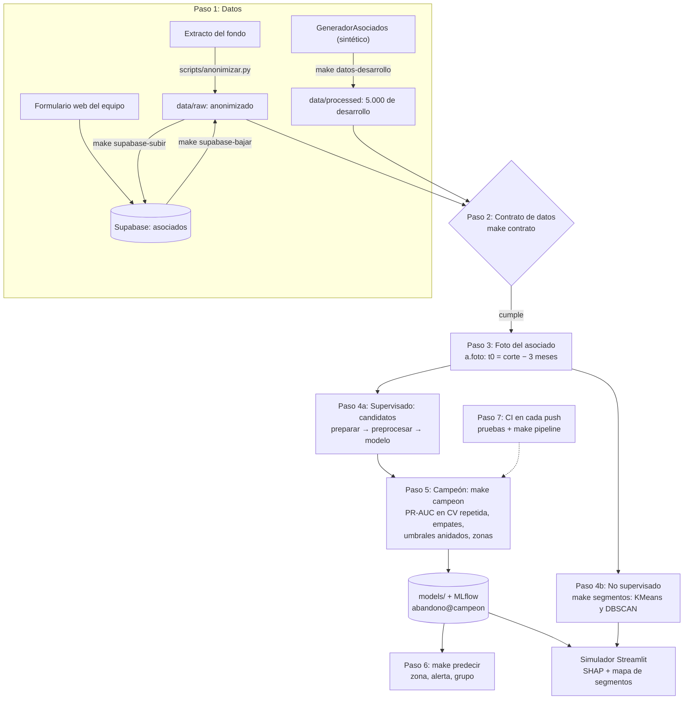

# Proyecto I — Especialización en Ciencia de Datos

[](https://github.com/juanccadavid/proyecto-ml/actions/workflows/ci.yml)

**Predicción de abandono de asociados de un fondo de empleados**, de punta a punta y con datos sintéticos.

**Problema:** anticipar qué asociados de un fondo de empleados se van a retirar en los próximos 3 meses, para
contactarlos a tiempo. Retener a un asociado cuesta menos que reemplazarlo, y el retiro es raro (pocos de cada
100), así que el modelo tiene que encontrar a los pocos que se van sin llenar de falsas alarmas al equipo.

**Cómo:** contrato de datos → anonimización → foto del asociado en t0 (sin fuga de información) → pipeline de
scikit-learn → campeón por PR-AUC en validación cruzada repetida, con umbrales medidos en validación anidada y
una prueba de estrés temporal → MLflow → predicción, simulador en Streamlit con SHAP y segmentos (KMeans, DBSCAN).

> **Estado (nov-2026): todo el sistema corre y está probado, pero solo con DATOS SINTÉTICOS.** El extracto real
> del fondo no ha llegado. Las métricas de este README salen del generador (`generador.py`): prueban que el
> sistema funciona, **no** cómo le irá al modelo con el fondo. Para datos reales hacen falta el extracto
> anonimizado y, en el `.env`, `ORIGEN_DATOS=real_anonimizado`, `FECHA_CORTE` y `DATOS_ASOCIADOS` (ver
> "Datos sintéticos y datos reales"), además de confirmar la temporalidad con el fondo.

> **¿Nuevo en el proyecto?** Empieza por [`docs/guia_comandos.txt`](docs/guia_comandos.txt): Git, uv, Make,
> imports, contratos, pipeline y generador de datos, con los comandos de este proyecto.

## Tecnologías

| Para qué | Con qué |
|---|---|
| Datos y contrato | pandas, Polars (ingesta), pandera (contrato de datos en tres niveles), Supabase (tabla + formulario web) |
| Modelos | scikit-learn (`Pipeline`, `ColumnTransformer`), imbalanced-learn, Optuna; PyCaret (opcional, para comparar) |
| Evaluación y explicación | PR-AUC, MCC, Brier, validación anidada, prueba t de Nadeau y Bengio, SHAP |
| Seguimiento | MLflow (experimentos, versión de los datos por huella, modelo registrado con alias) |
| App | Streamlit (simulador con SHAP y mapa de segmentos), Plotly |
| Calidad y entrega | uv (`uv.lock`), Ruff, mypy, pytest, pre-commit (gitleaks), GitHub Actions, Docker Compose |

## Instalación

- [uv](https://docs.astral.sh/uv/) (gestiona Python 3.12 y dependencias)
- Git. Opcionales: Docker Desktop, `make` (en Windows: Git Bash + `winget install ezwinports.make`)

```bash
git clone <url-del-repo> && cd <repo>
make setup        # uv sync (versiones exactas de uv.lock) + .env desde .env.example + hooks de pre-commit
```

**Windows y la salida redirigida.** Al redirigir la salida (`> log.txt` o a una tubería), Python en Windows
escribe con la página de códigos del sistema (cp1252) y falla con caracteres como `−`. `make` ya activa el modo
UTF-8 de Python (`PYTHONUTF8=1`). Sin `make`: `$env:PYTHONUTF8 = "1"` en PowerShell o `set PYTHONUTF8=1` en
CMD. Para leer bien esa salida en la consola de PowerShell 5.1:
`[Console]::OutputEncoding = [Text.UTF8Encoding]::new()`.

## Inicio rápido

Después de `make setup` (y de ajustar el `.env` si hace falta):

```bash
make demo                    # genera el dataset sintético y entrena con él (MLflow)
make train                   # entrena con DATA_PATH del .env (o: make train DATA=... ARGS="--pca 0.95")
make train ARGS="--clip-outliers iqr --clip-columns salario"  # además recorta atípicos de salario
make train ARGS="--sin-limpieza"  # sin la limpieza de cleaning.py, para comparar en MLflow
make mlflow-ui               # http://localhost:5000
make app                     # http://localhost:8501
make campeon                 # elige el modelo campeón, su umbral y zonas (MLflow: abandono@campeon)
make simulador               # http://localhost:8501: mueve las variables y mira si el asociado se retira
make pipeline                # todo el flujo: campeón, predicción, segmentos, validación cruzada, regresión
make tipos                   # mypy sobre src/proyecto_ml (también en el CI)
make check                   # lint + tipos + pruebas, antes de abrir un PR
```

**Pruebas** (`tests/`, pytest): `make test` corre todas (unas 310, unos 2-3 minutos). Cubren contrato de datos,
anonimización y PII, la foto y la fuga de información, el pipeline, el campeón y sus umbrales, la validación
temporal, la predicción, MLflow, el simulador (Streamlit `AppTest`) y los scripts. Para una sola:
`uv run pytest -q tests/test_campeon.py`.

`make` (sin argumentos) lista todos los objetivos. Sin `make`, cada objetivo del `Makefile` muestra
el comando `uv run ...` equivalente.

### Estructura frente a la plantilla del curso

| Plantilla | Aquí | Nota |
|---|---|---|
| `README.md`, `Makefile`, `pyproject.toml` | ✅ los mismos | `make` sin argumentos lista los comandos; dependencias con uv (`uv.lock`) |
| `.github/workflows/ci.yml` | ✅ | en cada push: lint + pruebas y, si pasan, `make pipeline` (ver abajo) |
| `notebooks/` | `sesiones/` | los notebooks de EDA y la bitácora del equipo |
| `src/<paquete>/config.py`, `data.py`, `features.py`, `train.py` | ✅ `src/proyecto_ml/` | |
| `model.py` | `models.py` | el catálogo de modelos; el abandono los arma en `abandono.armar_pipeline` |
| `predict.py` | ✅ `predict.py` | `make predecir DATA=...`: filas crudas de los activos → puntaje, zona, alerta y grupo |
| `app/` (Streamlit o FastAPI) | `streamlit_app.py` + `src/proyecto_ml/app_abandono.py` | Streamlit Cloud abre `streamlit_app.py` en la raíz |
| `tests/` | ✅ | pytest, con las pruebas del contrato en `tests/data/` |
| `models/` | ✅ gitignored | solo el campeón; el CI lo deja como artefacto |

### Integración continua: cada push deja el código ejecutado

[`.github/workflows/ci.yml`](.github/workflows/ci.yml) corre en **cada push, en cualquier rama** (y con el botón
*Run workflow* de la pestaña Actions):

1. **calidad**: `ruff` (lint y formato) y todas las pruebas, con las versiones exactas de `uv.lock`.
2. **ejecutar** (si la anterior pasa): `make pipeline`, que corre en orden `campeon`, `predecir`, `segmentos`,
   `validacion` y `regresion`, con un MLflow local del runner.
   - En la pestaña *Summary* de la corrida aparece el resumen del campeón: PR-AUC, recall, MCC y las zonas.
   - Las figuras, las métricas y el campeón quedan en el artefacto **resultados** (14 días).

Todo corre con datos generados (semilla fija): el extracto real nunca va a GitHub. Si haces otro push a la
misma rama mientras corre, se cancela la corrida vieja. Lo mismo se corre en local con `make pipeline`.

### Componentes Hugging Face (opcional)

```bash
uv sync --extra hf           # TabPFN + transformers (descarga torch, ~2 GB)
uv run python -m proyecto_ml.train --tabpfn
```

TabPFN: recomendado hasta ~50k filas; la licencia de la versión 2.5 **no permite uso comercial**;
en CPU es lento con miles de filas (usar Colab con GPU).

### Docker

```bash
docker compose up --build                            # simulador :8501 + servidor MLflow :5000
make docker-campeon                                  # elige el campeón dentro de Docker (ARGS=... como make campeon)
make down                                            # apaga todo (MLflow conserva sus datos en su volumen)
```

| Servicio | Qué hace | Escribe |
|---|---|---|
| `app` | El simulador (`app_abandono.py`) con el campeón de `models/`; sin campeón, lo elige al abrir con sintéticos | nada: `models/` y `data/` en solo lectura |
| `mlflow` | Servidor de MLflow; guarda experimentos y artefactos (los sirve por HTTP a los otros contenedores) | su volumen `mlflow_data` |
| `campeon` | Perfil `pipeline`, a pedido: `scripts/elegir_campeon.py` registrando en ese MLflow | `models/` y `reports/` |

Todos corren como `appuser` (uid 1000), sin root. La imagen no contiene datos ni modelos (`.dockerignore`): se
montan como volúmenes. En Linux, `models/` y `reports/` deben ser de ese uid para que `campeon` escriba
(`sudo chown -R 1000 models reports`). Si ya tenías el volumen de MLflow de una versión anterior (creado por
root), recréalo una vez: `docker compose down -v` (borra los experimentos guardados en Docker).

**Qué está verificado:** el CI (trabajo `docker`) valida el `docker-compose.yml`, construye la imagen, corre
`campeon` con MLflow en su contenedor, levanta `app` con ese campeón y espera su *healthcheck*. **No verificado en
el equipo de desarrollo** (no tiene Docker): Docker Desktop en Windows y abrir el simulador desde el navegador.

## Resultados

**Todas las cifras son de DATOS SINTÉTICOS** (5.000 de desarrollo, foto a 3 meses: 4.602 activos, 105 retiros,
2,3 %). Validan que el método funciona, no el rendimiento con el fondo. Salen de `make campeon`
(`models/campeon.json`, también en el resumen de cada corrida del CI).

| Evaluación | Modelo | PR-AUC (base 0,023) | Precisión / recall de la alerta |
|---|---|---|---|
| Validación cruzada repetida 5 × 3 (la que elige el campeón) | logística sin balancear | 0,918 ± 0,038 | 0,86 / 0,85 (umbral elegido con esas mismas predicciones) |
| Validación anidada de la regla de umbrales | logística sin balancear | — | 0,69 / 0,86 (umbral elegido sin ver la prueba) |
| Prueba de estrés temporal, ciega: con la foto a 2026-04-30 se elige el candidato, su umbral y se entrena; se mide en la de 2026-07-31 | Random Forest (el que gana en la foto vieja) | 0,831 | 0,93 / 0,37 |
| Prueba de estrés temporal, el campeón actual con el mismo procedimiento (su elección vio la foto reciente) | logística sin balancear | 0,848 | 0,51 / 0,87 |

**Cómo leer la prueba temporal: es una prueba de estrés, no una estimación fuera de tiempo.** Con un solo
extracto, las dos fotos son **las mismas personas con los mismos datos**: los 4.602 de la foto reciente están en
la vieja, 19 de las 21 variables son idénticas (solo EDAD y ANTIGUEDAD se corren 0,25 años) y los 105 retiros
de la foto reciente son exactamente 105 asociados que en la foto vieja cuentan como activos (se retiran después
de su corte). El modelo se entrena viéndolos con etiqueta 0 y se mide con etiqueta 1 sobre sus mismos datos. Eso
castiga a propósito: mide qué pasa si la etiqueta y los conteos no están alineados en el tiempo, que es justo el
riesgo de los conteos sin fecha (ver Limitaciones).

- **El ranking de modelos no es estable.** En la foto vieja todos los candidatos quedan entre 0,46 y 0,54 de
  PR-AUC fuera de partición y gana Random Forest por 0,004 sobre Ridge. En la foto reciente la logística gana con
  claridad (0,918 contra 0,859 de Random Forest). Los dos ordenan bien en la prueba (0,83-0,85 frente a una base
  de 0,023).
- **El umbral no se traslada.** El de la foto vieja da precisión 0,51 con la logística (umbral 0,05) y recall
  0,37 con Random Forest (0,12): los 105 "activos" de la foto vieja traen el comportamiento de retiro (1,69
  intenciones de retiro en promedio, como los positivos, 1,72, contra 0,19 de los activos) y corren el umbral.
- **Una validación fuera de tiempo de verdad** necesita extractos de fechas distintas, con cada conteo medido a
  su t0. Con un solo extracto (sintético o real) no existe; esta prueba no la reemplaza.
- **Límite de la elección ciega:** la lista de candidatos (y, con `--optuna`, sus hiperparámetros) se armó
  mirando datos que incluyen la foto reciente; eso no se repite.

## Arquitectura

### Estructura

```
├── src/proyecto_ml/      Código fuente (paquete instalable)
│   ├── config.py         Rutas y variables de entorno
│   ├── data.py           Carga, X/y y particiones (estratificada, temporal, por grupos)
│   ├── features.py       Imputación, escalado, codificación, binning, PCA, RFE (ColumnTransformer)
│   ├── models.py         Logística, Random Forest, HistGB, TabPFN (opcional)
│   ├── evaluate.py       PR-AUC, ROC-AUC, MCC, Kappa, recall@10 %, F1, importancia de variables
│   ├── train.py          Entrenamiento + MLflow + exportación del mejor modelo
│   ├── abandono.py       Modelos de abandono: supervisados (Ridge, logística, bagging, boosting) y KMeans
│   ├── busqueda_optuna.py  Optuna para afinar Random Forest y HistGB (make optuna)
│   ├── tecnicas.py       Compara técnicas de preprocesamiento y feature engineering (make tecnicas)
│   ├── correlacion.py    Correlación entre variables y con el objetivo (Spearman, V de Cramér)
│   ├── contrato.py       Contrato de datos (pandera, 3 niveles) + SQL de Supabase + campos del formulario
│   ├── generador.py      GeneradorAsociados: asociados ficticios con el esquema real
│   ├── anonymize.py      Hash con sal, eliminación de PII, agrupación en rangos
│   ├── synthetic.py      Generador sintético genérico (make demo)
│   ├── app.py            Demo Streamlit
│   ├── campeon.py        Modelo campeón: PR-AUC en CV repetida, umbrales, zonas, guardar/cargar (make campeon)
│   ├── campeon_figuras.py  Figuras del campeón: umbrales, matriz de confusión, ROC, calibración
│   ├── datos_campeon.py  Datos de entrada del campeón y de los exploratorios, según el origen y el contrato
│   ├── extractos.py      Varios extractos de fechas distintas: la foto para la validación fuera de tiempo
│   ├── explicar.py       SHAP: por qué el modelo le dio a cada asociado su puntaje
│   ├── validacion.py     Escenarios, partición temporal y KFold / Stratified / TimeSeriesSplit
│   ├── regresion.py      Regresión de ejemplo: el salario con MAE, MSE, RMSE y R² (make regresion)
│   ├── segmentacion.py   No supervisado: KMeans y DBSCAN + mapa interactivo de segmentos (make segmentos)
│   ├── predict.py        Predicción con el campeón guardado: zona, alerta y grupo (make predecir)
│   ├── registro.py       Registro en MLflow (experimento abandono, alias campeon)
│   └── app_abandono.py   Simulador Streamlit del abandono con el campeón (make simulador)
├── scripts/              Ingesta, anonimización, generadores, contrato, modelo de abandono
├── streamlit_app.py      Entrada de Streamlit Community Cloud (abre el simulador)
├── .github/workflows/    ci.yml (lint, mypy, pruebas, pre-commit, Docker y make pipeline en cada push) y formulario.yml
├── contratos/            Contratos de datos (YAML)
├── supabase/             SQL de la tabla y migraciones
├── web/                  Formulario para enviar asociados a Supabase
├── docs/                 Metodología, privacidad, contrato, MLflow, datos reales, licencia y guía de comandos
├── sesiones/             Notebooks (EDA) y bitácora del equipo
├── tests/                Pruebas unitarias e integración (pytest); tests/data: reglas del contrato
├── reports/              Métricas y figuras livianas (qué se versiona: reports/README.md)
├── data/                 Datos locales — NO van a Git
└── models/               Solo el campeón (y best_model de make train) — NO van a Git
```

### Flujo del proyecto

Del dato crudo a la predicción, en orden. Cada caja es un paso con su comando (`make <objetivo>`) y el módulo
que lo hace.



| Paso | Qué pasa | Comando | Dónde |
|---|---|---|---|
| **1. Datos** | Tres fuentes con el mismo esquema. El extracto real se anonimiza **antes** de compartirlo. El equipo carga asociados desde el formulario a Supabase. Mientras llega el extracto, se trabaja con 5.000 asociados sintéticos. | `scripts/anonimizar.py`, `make supabase-bajar`, `make datos-desarrollo` | `anonymize.py`, `contrato.py`, `generador.py` |
| **2. Contrato** | Columnas, tipos, rangos y reglas del negocio. Un lote que no cumple no sigue. | `make contrato DATA=...` (o `scripts/ingesta.py --contrato contratos/asociados.yaml`) | `contratos/asociados.yaml`, `contrato.py` |
| **3. Foto** | Cada asociado activo en t0 (corte − 3 meses): ¿se retira antes del corte? EDAD y ANTIGUEDAD se calculan a t0, sin fuga. | por defecto en `make campeon`, `tecnicas`, `validacion` y `segmentos` (`--horizonte 0` la apaga); `make abandono` solo con `--horizonte`; `afinar`, `optuna` y `pycaret` nunca | `abandono.foto`, `abandono.preparar` |
| **4a. Supervisado** | Un solo pipeline para todos los modelos: preparar → preprocesar (imputar, codificar, escalar, recortar) → modelo. Los candidatos son una lista fija (`campeon.lista_candidatos`): los 4 supervisados y la logística sin balancear y con TargetEncoder, que ganaron de forma concluyente en un `make tecnicas` anterior. | `make tecnicas`, `make validacion` | `abandono.armar_pipeline`, `features.py`, `tecnicas.py` |
| **4b. No supervisado** | Segmentos por comportamiento, sin ver el retiro. Los atípicos de DBSCAN concentran el retiro. | `make segmentos` | `segmentacion.py` |
| **5. Campeón** | Gana la mejor PR-AUC en validación cruzada repetida (5 × 3), con su incertidumbre: ± entre particiones, intervalo bootstrap y empates. Los umbrales (F2 y precisión ≥ 0,8) se miden también en validación anidada. Se valida además en el tiempo (entrena con la foto vieja, mide en la reciente con el umbral de la vieja) y, con sintéticos, con asociados nuevos y escenarios de señal débil. | `make campeon` | `campeon.py`, `validacion.py`, `explicar.py` (SHAP) |
| **6. Uso** | El campeón guardado recibe la fila cruda de cada asociado **activo** (los que ya se retiraron no se puntúan) y devuelve la zona: se retira, zona gris o se queda. | `make predecir DATA=...`, `make simulador` | `predict.py`, `app_abandono.py` |
| **7. CI** | En cada push: lint, pruebas y el flujo completo, con el resumen del campeón y los resultados como artefacto. | `make pipeline` (lo mismo en local) | `.github/workflows/ci.yml`, `scripts/resumen_campeon.py` |

## Datos sintéticos y datos reales

Hoy todo corre con **datos sintéticos** (`GeneradorAsociados`): sirven para construir y probar el sistema, **no son
evidencia** de cómo le irá al modelo con el fondo. Cuando llegue el extracto anonimizado, el mismo pipeline lo usa
cambiando una sola línea del `.env`:

```bash
ORIGEN_DATOS=sintetico            # por defecto
ORIGEN_DATOS=real_anonimizado     # y luego: make campeon DATA=data/raw/extracto_anon.parquet
```

| | `sintetico` | `real_anonimizado` |
|---|---|---|
| De dónde salen los datos | `--datos`, o `data/processed/asociados_desarrollo.parquet`, o el generador en memoria | **solo** `--datos` (sin él, falla: nunca cae en los generados) |
| Contrato de datos | el **de origen**, a todo archivo | el **del dataset anonimizado para ML** (`contrato.para_ml`: sin PII, con seudónimos); el error dice cuántas filas y qué columnas, **sin valores** (`contrato.sin_valores`). Ver [docs/privacidad.md](docs/privacidad.md#privacidad-dos-contratos-y-la-anonimización) |
| Asociados nuevos y escenarios del generador | sí (validación sobre datos que el modelo no vio) | no: serían de otro origen. La validación de afuera es la temporal (`validacion.particion_temporal`) |
| MLflow | experimentos `abandono`, `salario`; modelo `abandono` | experimentos `abandono_real`, `salario_real`; modelo `abandono_real` |
| Etiqueta en consola, `campeon.json`, resumen del CI y simulador | **MODO SINTÉTICO: resultados experimentales** | DATOS REALES ANONIMIZADOS |

Con datos reales, además: **`FECHA_CORTE`** (`.env`) debe ser la fecha de extracción, porque la foto se toma
3 meses antes; si el archivo trae fechas posteriores, `make campeon` se detiene. Y el simulador comprueba que
`DATOS_ASOCIADOS` sea el mismo extracto con que se eligió el campeón (misma huella): si no, se detiene en vez
de explicar un modelo real con datos de otro origen. Las figuras de un resultado sintético llevan la marca
"DATOS SINTÉTICOS · resultado experimental".

Las métricas de los dos orígenes nunca quedan en la misma tabla de MLflow ni en el mismo `campeon.json`. El
contrato es el que se conoce hoy (`contratos/asociados.yaml`): si el extracto real trae otras columnas o
categorías, el contrato lo detiene antes de entrenar, y se ajusta el contrato con el equipo, no el modelo a ciegas.

## Limitaciones

- **Sin datos reales.** El generador fija la señal: el modelo aprende la regla del generador. Los "escenarios"
  de `make campeon` miden cuánto se degrada si la señal real es más débil; no la reemplazan.
- **Temporalidad sin confirmar.** Los conteos (`abandono.CONTEOS_SIN_FECHA`) y atributos como salario, cargo y
  agencia (`abandono.ATRIBUTOS_SIN_FECHA`) llegan sin fecha de medición. Si son a la extracción y no a t0, hay
  fuga. Con datos reales, la evaluación queda marcada como no válida hasta que el fondo lo confirme
  (`TEMPORALIDAD_CONFIRMADA`).
- **Un solo extracto: no hay validación fuera de tiempo.** Las dos fotos de la prueba temporal son las mismas
  personas con los mismos datos (ver Resultados). La infraestructura para la de verdad ya está
  (`make fuera-de-tiempo`, `extractos.py`): necesita 3 o más extractos reales de fechas distintas, con requisitos
  en [`docs/datos_reales.md`](docs/datos_reales.md).
- **No está validado para producción.** Hasta tener esa validación con datos reales, ninguna cifra de este README
  dice cómo le irá al modelo con el fondo.
- **SHAP explica el modelo, no la causa** del retiro: dice qué variables mueven el puntaje, no qué haría que
  alguien se quede.

**Pendiente** (necesita al fondo o datos reales): el extracto anonimizado, la confirmación de la temporalidad,
el rango de la tasa de retiro del contrato (hoy es solo una advertencia) y la licencia (propuesta MIT pendiente
de aprobación: [`docs/licencia.md`](docs/licencia.md)).

## Documentación

| Documento | Qué tiene |
|---|---|
| [`docs/metodologia.md`](docs/metodologia.md) | Modelos de abandono: la foto del asociado y la fuga de información, el pipeline, el campeón y sus umbrales, la incertidumbre, la validación temporal, SHAP, segmentación (KMeans, DBSCAN), validación cruzada, regresión, técnicas, afinamiento, Optuna y PyCaret, y qué métrica usamos y por qué |
| [`docs/contrato_y_supabase.md`](docs/contrato_y_supabase.md) | Los tres niveles del contrato de datos, la tabla de Supabase y el formulario web |
| [`docs/privacidad.md`](docs/privacidad.md) | Datos personales: los dos contratos, la anonimización, la detección de PII, las predicciones sin PII y la fecha de corte y la temporalidad |
| [`docs/mlflow.md`](docs/mlflow.md) | Experimentos y modelo registrado en MLflow, la versión liviana de los datos |
| [`docs/datos_reales.md`](docs/datos_reales.md) | Requisitos de los extractos reales y el procedimiento de la validación fuera de tiempo (`make fuera-de-tiempo`) |
| [`docs/licencia.md`](docs/licencia.md) | Propuesta de licencia (MIT, pendiente de aprobación), qué cubre y las licencias de las dependencias |
| [`docs/guia_comandos.txt`](docs/guia_comandos.txt) | Guía para empezar: Git, uv, Make, imports, contratos y cada comando del proyecto |
| [`CONTRIBUTING.md`](CONTRIBUTING.md) | Ramas, commits y Pull Requests |

## Respaldo offline

`make bundle` genera `rediseno-v3.bundle` (historial completo de Git en un archivo). Se restaura con
`git clone rediseno-v3.bundle carpeta`. No se versiona.

## Equipo

Ver [CONTRIBUTING.md](CONTRIBUTING.md) para el flujo de ramas y Pull Requests.
