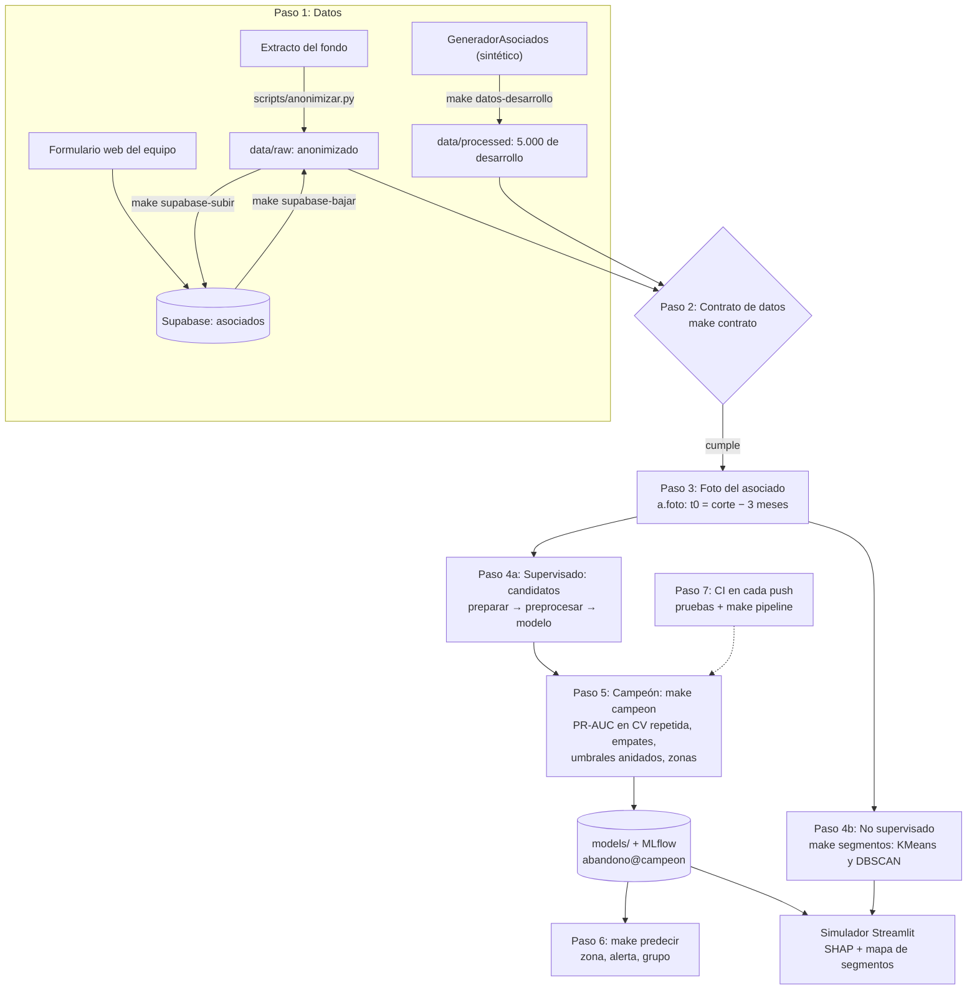

# Proyecto I — Especialización en Ciencia de Datos

Proyecto de clasificación supervisada de punta a punta: EDA con Plotly, preprocesamiento con
`Pipeline` + `ColumnTransformer`, comparación de al menos 2 modelos, seguimiento de experimentos con
MLflow y demo en Streamlit.

> **Estado:** estructura base lista y probada con un **dataset sintético**. El dataset definitivo está por
> definir (ver `sesiones/bitacora.md`). Cambiarlo solo requiere ajustar el `.env`.

> **¿Nuevo en el proyecto?** Empieza por [`docs/guia_comandos.txt`](docs/guia_comandos.txt): Git, uv, Make,
> imports, contratos, pipeline y generador de datos, con los comandos de este proyecto.

## Estructura

```
├── src/proyecto_ml/      Código fuente (paquete instalable)
│   ├── config.py         Rutas y variables de entorno
│   ├── data.py           Carga, X/y y particiones (estratificada, temporal, por grupos)
│   ├── features.py       Imputación, escalado, codificación, binning, PCA, RFE (ColumnTransformer)
│   ├── models.py         Logística, Random Forest, HistGB, TabPFN (opcional)
│   ├── evaluate.py       PR-AUC, ROC-AUC, MCC, Kappa, recall@10 %, F1, importancia de variables
│   ├── train.py          Entrenamiento + MLflow + exportación del mejor modelo
│   ├── abandono.py       Modelos de abandono: supervisados (Ridge, logística, bagging, boosting) y KMeans
│   ├── busqueda_optuna.py  Optuna para afinar Random Forest y HistGB (make optuna)
│   ├── tecnicas.py       Compara técnicas de preprocesamiento y feature engineering (make tecnicas)
│   ├── correlacion.py    Correlación entre variables y con el objetivo (Spearman, V de Cramér)
│   ├── contrato.py       Contrato de datos (pandera, 3 niveles) + SQL de Supabase + campos del formulario
│   ├── generador.py      GeneradorAsociados: asociados ficticios con el esquema real
│   ├── anonymize.py      Hash con sal, eliminación de PII, agrupación en rangos
│   ├── synthetic.py      Generador sintético genérico (make demo)
│   ├── app.py            Demo Streamlit
│   ├── campeon.py        Modelo campeón: PR-AUC en CV repetida, umbrales, zonas, ROC y confusión (make campeon)
│   ├── explicar.py       SHAP: por qué el modelo le dio a cada asociado su puntaje
│   ├── validacion.py     Escenarios, partición temporal y KFold / Stratified / TimeSeriesSplit
│   ├── regresion.py      Regresión de ejemplo: el salario con MAE, MSE, RMSE y R² (make regresion)
│   ├── segmentacion.py   No supervisado: KMeans y DBSCAN + mapa interactivo de segmentos (make segmentos)
│   ├── predict.py        Predicción con el campeón guardado: zona, alerta y grupo (make predecir)
│   ├── registro.py       Registro en MLflow (experimento abandono, alias campeon)
│   └── app_abandono.py   Simulador Streamlit del abandono con el campeón (make simulador)
├── scripts/              Ingesta, anonimización, generadores, contrato, modelo de abandono
├── streamlit_app.py      Entrada de Streamlit Community Cloud (abre el simulador)
├── .github/workflows/    ci.yml (lint + pruebas + make pipeline en cada push) y formulario.yml (Pages)
├── contratos/            Contratos de datos (YAML)
├── supabase/             SQL de la tabla y migraciones
├── web/                  Formulario para enviar asociados a Supabase
├── docs/                 Guía de comandos y conceptos (docs/guia_comandos.txt)
├── sesiones/             Notebooks (EDA) y bitácora del equipo
├── tests/                Pruebas unitarias e integración (pytest); tests/data: reglas del contrato
├── reports/              Métricas y figuras versionables
├── data/                 Datos locales — NO van a Git
└── models/               Solo el campeón (y best_model de make train) — NO van a Git
```

## Flujo del proyecto

Del dato crudo a la predicción, en orden. Cada caja es un paso con su comando (`make <objetivo>`) y el módulo
que lo hace.



| Paso | Qué pasa | Comando | Dónde |
|---|---|---|---|
| **1. Datos** | Tres fuentes con el mismo esquema. El extracto real se anonimiza **antes** de compartirlo. El equipo carga asociados desde el formulario a Supabase. Mientras llega el extracto, se trabaja con 5.000 asociados sintéticos. | `scripts/anonimizar.py`, `make supabase-bajar`, `make datos-desarrollo` | `anonymize.py`, `contrato.py`, `generador.py` |
| **2. Contrato** | Columnas, tipos, rangos y reglas del negocio. Un lote que no cumple no sigue. | `make contrato DATA=...` (o `scripts/ingesta.py --contrato contratos/asociados.yaml`) | `contratos/asociados.yaml`, `contrato.py` |
| **3. Foto** | Cada asociado activo en t0 (corte − 3 meses): ¿se retira antes del corte? EDAD y ANTIGUEDAD se calculan a t0, sin fuga. | (dentro de todos los comandos) | `abandono.foto`, `abandono.preparar` |
| **4a. Supervisado** | Un solo pipeline para todos los modelos: preparar → preprocesar (imputar, codificar, escalar, recortar) → modelo. Los candidatos son los 4 supervisados y las técnicas que ganan de forma concluyente. | `make tecnicas`, `make optuna`, `make validacion` | `abandono.armar_pipeline`, `features.py`, `tecnicas.py` |
| **4b. No supervisado** | Segmentos por comportamiento, sin ver el retiro. Los atípicos de DBSCAN concentran el retiro. | `make segmentos` | `segmentacion.py` |
| **5. Campeón** | Gana la mejor PR-AUC en validación cruzada repetida (5 × 3), con su incertidumbre: ± entre particiones, intervalo bootstrap y empates. Los umbrales (F2 y precisión ≥ 0,8) se miden también en validación anidada. Se valida además con asociados nuevos y con escenarios de señal débil. | `make campeon` | `campeon.py`, `validacion.py`, `explicar.py` (SHAP) |
| **6. Uso** | El campeón guardado recibe la fila cruda y devuelve la zona: se retira, zona gris o se queda. | `make predecir DATA=...`, `make simulador` | `predict.py`, `app_abandono.py` |
| **7. CI** | En cada push: lint, pruebas y el flujo completo, con el resumen del campeón y los resultados como artefacto. | `make pipeline` (lo mismo en local) | `.github/workflows/ci.yml`, `scripts/resumen_campeon.py` |

## Datos sintéticos y datos reales

Hoy todo corre con **datos sintéticos** (`GeneradorAsociados`): sirven para construir y probar el sistema, **no son
evidencia** de cómo le irá al modelo con el fondo. Cuando llegue el extracto anonimizado, el mismo pipeline lo usa
cambiando una sola línea del `.env`:

```bash
ORIGEN_DATOS=sintetico            # por defecto
ORIGEN_DATOS=real_anonimizado     # y luego: make campeon DATA=data/raw/extracto_anon.parquet
```

| | `sintetico` | `real_anonimizado` |
|---|---|---|
| De dónde salen los datos | `--datos`, o `data/processed/asociados_desarrollo.parquet`, o el generador en memoria | **solo** `--datos` (sin él, falla: nunca cae en los generados) |
| Contrato de datos | se exige a todo archivo | se exige; el error dice cuántas filas y qué columnas, **sin valores** (`contrato.sin_valores`) |
| Asociados nuevos y escenarios del generador | sí (validación sobre datos que el modelo no vio) | no: serían de otro origen. La validación de afuera es la temporal (`validacion.particion_temporal`) |
| MLflow | experimentos `abandono`, `salario`; modelo `abandono` | experimentos `abandono_real`, `salario_real`; modelo `abandono_real` |
| Etiqueta en consola, `campeon.json`, resumen del CI y simulador | **MODO SINTÉTICO: resultados experimentales** | DATOS REALES ANONIMIZADOS |

Las métricas de los dos orígenes nunca quedan en la misma tabla de MLflow ni en el mismo `campeon.json`. El
contrato es el que se conoce hoy (`contratos/asociados.yaml`): si el extracto real trae otras columnas o
categorías, el contrato lo detiene antes de entrenar, y se ajusta el contrato con el equipo, no el modelo a ciegas.

## Requisitos

- [uv](https://docs.astral.sh/uv/) (gestiona Python 3.12 y dependencias)
- Git. Opcionales: Docker Desktop, `make` (en Windows: Git Bash + `winget install ezwinports.make`)

## Inicio rápido

```bash
git clone <url-del-repo> && cd <repo>
make setup                   # uv sync + .env desde .env.example + hooks de pre-commit
# (ajustar valores del .env)

make demo                    # genera el dataset sintético y entrena con él (MLflow)
make train                   # entrena con DATA_PATH del .env (o: make train DATA=... ARGS="--pca 0.95")
make train ARGS="--clip-outliers iqr --clip-columns salario"  # además recorta atípicos de salario
make train ARGS="--sin-limpieza"  # sin la limpieza de cleaning.py, para comparar en MLflow
make mlflow-ui               # http://localhost:5000
make app                     # http://localhost:8501
make campeon                 # elige el modelo campeón, su umbral y zonas (MLflow: abandono@campeon)
make simulador               # http://localhost:8501: mueve las variables y mira si el asociado se retira
make pipeline                # todo el flujo: campeón, predicción, segmentos, validación cruzada, regresión
make check                   # lint + pruebas, antes de abrir un PR
```

`make` (sin argumentos) lista todos los objetivos. Sin `make`, cada objetivo del `Makefile` muestra
el comando `uv run ...` equivalente.

### Estructura frente a la plantilla del curso

| Plantilla | Aquí | Nota |
|---|---|---|
| `README.md`, `Makefile`, `pyproject.toml` | ✅ los mismos | `make` sin argumentos lista los comandos; dependencias con uv (`uv.lock`) |
| `.github/workflows/ci.yml` | ✅ | en cada push: lint + pruebas y, si pasan, `make pipeline` (ver abajo) |
| `notebooks/` | `sesiones/` | los notebooks de EDA y la bitácora del equipo |
| `src/<paquete>/config.py`, `data.py`, `features.py`, `train.py` | ✅ `src/proyecto_ml/` | |
| `model.py` | `models.py` | el catálogo de modelos; el abandono los arma en `abandono.armar_pipeline` |
| `predict.py` | ✅ `predict.py` | `make predecir DATA=...`: filas crudas → puntaje, zona, alerta y grupo |
| `app/` (Streamlit o FastAPI) | `streamlit_app.py` + `src/proyecto_ml/app_abandono.py` | Streamlit Cloud abre `streamlit_app.py` en la raíz |
| `tests/` | ✅ | pytest, con las pruebas del contrato en `tests/data/` |
| `models/` | ✅ gitignored | solo el campeón; el CI lo deja como artefacto |

### Integración continua: cada push deja el código ejecutado

[`.github/workflows/ci.yml`](.github/workflows/ci.yml) corre en **cada push, en cualquier rama** (y con el botón
*Run workflow* de la pestaña Actions):

1. **calidad**: `ruff` (lint y formato) y todas las pruebas, con las versiones exactas de `uv.lock`.
2. **ejecutar** (si la anterior pasa): `make pipeline`, que corre en orden `campeon`, `predecir`, `segmentos`,
   `validacion` y `regresion`, con un MLflow local del runner.
   - En la pestaña *Summary* de la corrida aparece el resumen del campeón: PR-AUC, recall, MCC y las zonas.
   - Las figuras, las métricas y el campeón quedan en el artefacto **resultados** (14 días).

Todo corre con datos generados (semilla fija): el extracto real nunca va a GitHub. Si haces otro push a la
misma rama mientras corre, se cancela la corrida vieja. Lo mismo se corre en local con `make pipeline`.

### Componentes Hugging Face (opcional)

```bash
uv sync --extra hf           # TabPFN + transformers (descarga torch, ~2 GB)
uv run python -m proyecto_ml.train --tabpfn
```

TabPFN: recomendado hasta ~50k filas; la licencia de la versión 2.5 **no permite uso comercial**;
en CPU es lento con miles de filas (usar Colab con GPU).

### Docker

```bash
docker compose up --build    # simulador :8501 + servidor MLflow :5000
```

La imagen no contiene datos ni modelos: `data/` y `models/` se montan como volúmenes de solo lectura.
El servicio `app` corre el simulador del abandono (`app_abandono.py`) con el campeón de `models/`; sin
él, lo elige al arrancar. `app.py` queda como la demo genérica de la plantilla (`make app`).

## Modelos de abandono (supervisados y KMeans)

`make abandono` responde "¿este asociado abandona el fondo?" con dos enfoques
([`src/proyecto_ml/abandono.py`](src/proyecto_ml/abandono.py)):

- **Supervisados** (aprenden de `#RETIROS`), con el mismo preprocesador: métricas en entrenamiento,
  validación cruzada y datos nuevos, más una tabla que los compara sobre los nuevos.

  | Modelo | Tipo | Idea |
  |---|---|---|
  | Ridge | lineal | regresión con penalización sobre la clase -1/+1; coeficientes interpretables |
  | Regresión logística | lineal | probabilidad de abandono; también interpretable |
  | Random Forest | **bagging** | muchos árboles independientes (muestras bootstrap) que votan |
  | HistGradientBoosting | **boosting** | árboles en secuencia, cada uno corrige al anterior (estilo LightGBM) |
- **KMeans** (sin objetivo): agrupa por comportamiento (solicitudes, ahorros, intención de retiro) en 2 grupos;
  el de "riesgo" se elige por su perfil, no por el objetivo. Después se compara con el abandono real.

Para validar, se generan asociados **que los modelos nunca vieron** (mismo generador, otra semilla):

```bash
make abandono                                        # entrena con data/ejemplo, valida con 1000 nuevos
make abandono ARGS="--nuevos 5000 --semilla-nuevos 7 --alpha 10"
make abandono ARGS="--validar mi_archivo.parquet"    # validar además con otro archivo
make abandono ARGS="--sin-limpieza"                  # sin la limpieza de cleaning.py, para comparar
```

**Limpieza activa por defecto** ([`cleaning.py`](src/proyecto_ml/cleaning.py), de Juan Sebastián):

| Paso | Dónde | Qué hace |
|---|---|---|
| `contrato.limpiar_extracto` | al cargar (`a.cargar`), antes de partir | espacios, textos tipo 'N/A' → vacío, números como texto, filas repetidas |
| `ColumnDropper(max_missing=0.5)` | dentro del pipeline (aprende en train) | descarta variables con más de 50 % vacías o con un solo valor |
| `OutlierClipper("iqr")` | rama `clip` del pipeline | recorta atípicos de `SALARIO`, `EDAD` y `ANTIGUEDAD` (no los conteos) |

**Qué variables aportan a cada modelo.** `make abandono` calcula la *permutation importance* sobre los
asociados nuevos: desordena una variable a la vez y mide cuánto cae el AUC. Sirve igual para los cuatro
modelos (HistGB no trae `feature_importances_`) y mide la variable completa, no cada columna del OneHot.
Imprime las 5 principales de cada modelo y guarda `reports/figures/abandono_importancia.png`.

Además, para el Random Forest, `reports/figures/abandono_importancia_rf.html` es un gráfico **interactivo**
(Plotly: al pasar el mouse muestra variable e importancia) con su `feature_importances_` por columna ya
transformada, con el prefijo de su rama (`num__`, `clip__`, `cat__SEXO_F`...). Es la importancia propia del
bosque (cuánto reduce la impureza): favorece a las continuas como `SALARIO` o `EDAD`, que en la de
permutación casi no pesan. En código: `figura_importancia_interactiva(importancia_arbol(rf), "titulo")`.

Al final imprime una **tabla comparativa** al estilo de `compare_models` de PyCaret: Accuracy, AUC, Recall,
Prec., F1, Kappa, MCC y **TT (Sec)** (tiempo promedio de entrenamiento por partición), con validación cruzada
y las mismas particiones para todos. Se guarda en `reports/figures/abandono_comparativa.html` con el mejor
de cada columna en amarillo. Se ordena con `make abandono ARGS="--ordenar Recall"` (o `"--ordenar 'TT (Sec)'"`).
En un notebook: `resaltar(tabla_comparativa(modelos, X, y))` de `proyecto_ml.evaluate`.

**Un solo pipeline para todos** (`abandono.armar_pipeline`). Supervisados, campeón, Optuna, `make afinar` y
`make tecnicas` arman el modelo con la misma fábrica:

```
preparar → [crear variables] → preprocess → [SMOTE/ADASYN] → model
```

El primer paso (`PrepararVariables`) calcula EDAD y ANTIGUEDAD y elige las columnas. Por eso el modelo recibe la
**fila tal como llega** (extracto, Supabase, formulario): `modelo.predict(df)`, sin llamar a `preparar()` antes.
Eso vale también para el campeón guardado y para `models:/abandono@campeon` en MLflow. Si la fila ya viene
preparada, la deja igual; así siguen funcionando el simulador y la importancia por permutación.

```python
X, y = a.separar(vista)  # quita #RETIROS; el pipeline prepara el resto
modelo = a.armar_pipeline(LogisticRegression(class_weight="balanced"), crear_variables=True, scaler="robust")
modelo.fit(X, y).predict_proba(fila_de_supabase)
a.armar_pipeline(modelo_rf, buscable=True)  # preprocess__<opción> para GridSearchCV u Optuna
```

**Diagrama de los pipelines.** `make abandono` guarda `reports/figures/abandono_pipelines.html` con el diagrama
interactivo de cada modelo (el mismo de Jupyter): `PrepararVariables`, el `ColumnTransformer` con su rama
numérica (SimpleImputer → StandardScaler) y su rama categórica (SimpleImputer → OneHotEncoder), y luego el modelo. Cada caja se despliega con
un clic para ver parámetros y columnas. `make afinar` hace lo mismo con los afinados en
`afinamiento_pipelines.html`: ahí se ve que PyCaret usa OrdinalEncoder en la rama categórica. En un notebook basta
con dejar el pipeline al final de una celda; desde código: `pagina_pipelines({"ridge": modelo})` de
`proyecto_ml.features`.

Se excluyen las columnas que solo existen porque el asociado ya se fue (fecha/motivo de retiro, `ESTADO`,
fechas de actualización...): con ellas cualquier modelo acierta el 100 % pero no anticipa nada.

### La foto del asociado: fecha de observación y horizonte

Sin opciones, el modelo mira a todos los asociados **al corte** (31-oct-2026): EDAD y ANTIGUEDAD se miden
después de que los retirados se fueron, y como el generador reparte los retiros en los 12 meses anteriores,
en la práctica predice "¿se retiró en el último año?". El diseño correcto es una **foto** en t0 = corte − H:

- **Población:** asociados activos en t0 (los que se retiraron antes ya no eran asociados en la foto).
- **Objetivo:** `#RETIROS` = 1 si se retira entre t0 y el corte (usa `FECHARETIRO`).
- **Variables:** EDAD y ANTIGUEDAD a t0 (`preparar` lee la columna `FECHA_OBSERVACION` que agrega `foto`).

```python
vista = a.foto(df, horizonte_meses=3)  # t0 = 2026-07-31
X, y = a.separar(vista)  # el pipeline calcula EDAD y ANTIGUEDAD a t0
a.resumen_foto(df)  # por horizonte: asociados, retiros y tasa en la foto
```

| Datos | Foto a 3 meses | Foto a 12 meses (= sin foto) |
|---|---|---|
| 50 de `data/ejemplo` | 39 asociados, **1 retiro** | 50, 12 retiros (24 %) |
| 2.000 generados (semilla 7) | 1.535 asociados, **135 retiros (8,8 %)** | 2.000, 600 retiros (30 %) |

Con 50 filas la foto no deja con qué entrenar, así que es opcional (`--horizonte`) y se usa con más filas:

```bash
make ejemplo ARGS="--rows 2000 --seed 7 --output-dir data/processed --nombre asociados_2000"
make abandono DATA=data/processed/asociados_2000.parquet ARGS="--horizonte 3"
```

Ojo: los conteos de solicitudes (`ULT3MESES`...) se toman como vienen. Si el extracto los mide a la fecha de
extracción y no a t0, para los retirados incluyen lo que pasó después de irse (fuga). Hay que confirmarlo con
el fondo. EDA de la foto: [`sesiones/02_juan_eda_foto_asociado.ipynb`](sesiones/02_juan_eda_foto_asociado.ipynb).

### El modelo campeón: `make campeon`

Los afinados, Optuna y PyCaret son **experimentos** (quedan en MLflow); el **campeón** es el único modelo
"oficial": lo usa el simulador ([`campeon.py`](src/proyecto_ml/campeon.py),
[`scripts/elegir_campeon.py`](scripts/elegir_campeon.py)).

- **Datos:** los de desarrollo, 5.000 asociados generados con semilla 7 y **10 % de retiro** (más cerca de un
  fondo real que el 30 % por defecto), con la foto a 3 meses: 4.602 asociados, 105 retiros (2,3 %). `make
  datos-desarrollo` los escribe en `data/processed/`; sin el archivo se generan en memoria, idénticos. Los 50
  de `data/ejemplo` quedan para el contrato y las pruebas.
- **Criterio:** PR-AUC promedio en validación cruzada **repetida** (5 particiones × 3 repeticiones), no en los
  "nuevos" del generador. PR-AUC y no AUC: con 2 % de retiros el AUC pasa de 0,97 en todos los modelos.
- **Candidatos:** los 4 supervisados y las técnicas que en `make tecnicas` le ganan a la base de forma
  concluyente (ver "Incertidumbre" abajo); con `--optuna N`, también los árboles afinados con Optuna.
- **Umbrales**, con las predicciones fuera de partición (cada asociado puntuado por un modelo que no lo vio):
  - *alerta*: el que maximiza **F2** (el recall pesa el doble: perder a quien se va cuesta más que una llamada);
  - *alto*: el menor puntaje desde el cual **al menos 8 de cada 10 alertas son retiros reales**.
- **Tres zonas:** 😟 **se retira** (≥ alto) · 😐 **zona gris** (entre los dos) · 😀 **se queda** (< alerta).
- **KMeans** con los mismos datos y sin el objetivo: el simulador muestra en qué grupo cae el asociado y la
  tasa de retiro real del grupo.

| Candidato | PR-AUC ± entre particiones | IC 95 % (bootstrap) | campeón − candidato (IC 95 %) | umbral alerta | precisión / recall |
|---|---|---|---|---|---|
| **Logística sin balancear (campeón)** | **0,918 ± 0,038** | 0,88–0,96 | — | 0,31 | 0,86 / 0,85 |
| Logística + TargetEncoder | 0,906 ± 0,041 | 0,87–0,95 | 0,006 (−0,023 a 0,035) | 0,96 | 0,92 / 0,84 |
| Ridge | 0,890 ± 0,046 | 0,85–0,94 | 0,025 (−0,005 a 0,055) | 0,10 | 0,75 / 0,90 |
| HistGradientBoosting (boosting) | 0,868 ± 0,043 | 0,83–0,93 | 0,043 (0,010 a 0,076) ✔ | 0,12 | 0,68 / 0,88 |
| Regresión logística | 0,865 ± 0,053 | 0,82–0,92 | 0,044 (0,015 a 0,073) ✔ | 0,88 | 0,72 / 0,86 |
| Random Forest (bagging) | 0,859 ± 0,060 | 0,81–0,92 | 0,046 (−0,005 a 0,098) | 0,14 | 0,70 / 0,89 |

✔ = el campeón lo supera de forma concluyente (el intervalo de la diferencia no toca el 0). Contra los demás, **la elección no es concluyente**: la diferencia cabe en el ruido. Entre los empatados, la logística sin balancear es además la más simple de leer (un coeficiente por variable), así que la dejamos.

El umbral de alerta (máximo F2) ya alcanza la precisión pedida (0,86 ≥ 0,8), así que coincide con el umbral alto y **no queda zona gris**: cada alerta es "se retira". Zonas con 4.635 asociados nuevos (foto a 3 meses): **se retira** 98 (83 se retiran, 85 %), **se queda** 4.537 (21 se retiran). KMeans: en el grupo "riesgo" se retira el 13,5 %; en el "estable", el 0,9 %.

Guarda solo el campeón en `models/`:

- `abandono_campeon.joblib`, con el pipeline y sus dos umbrales juntos (`campeon.ModeloZonas`);
- `abandono_kmeans.joblib`;
- `campeon.json`, con el modelo, los umbrales, las métricas de todos los candidatos, los grupos, los datos y la
  fecha.

También guarda los gráficos de `reports/figures/` (umbrales, escenarios, ROC, matriz de confusión y SHAP: ver
abajo) y registra el campeón en MLflow con el alias `campeon`.

El modelo guardado recibe la fila cruda y **devuelve la zona**. Lo mismo hace el registrado en MLflow:

```python
campeon = mlflow.sklearn.load_model("models:/abandono@campeon")  # o: c.cargar(MODELS_DIR)[0]
campeon.predict(filas)  # ["se queda", "zona gris", "se retira", ...]
campeon.predict_proba(filas)  # el puntaje (decision_function si es Ridge)
campeon.alerta(filas)  # 1 desde el umbral de alerta
```

Un campeón guardado antes de este cambio (solo el pipeline) se carga igual: `c.cargar` lo envuelve con los
umbrales de `campeon.json`. KMeans también recibe la fila cruda (`agrupador.predict(filas)`).

```bash
make campeon                                     # foto a 3 meses, datos de desarrollo
make campeon ARGS="--horizonte 12 --precision-min 0.9"
make campeon DATA=data/raw/supabase_asociados.parquet   # con el extracto, cuando llegue
make simulador                                   # usa el campeón
```

#### Incertidumbre: qué tan seguros estamos de cada cifra

- **± es entre particiones, no entre repeticiones.** La PR-AUC del campeón varía ± 0,038 de una
  partición a otra (15 puntajes); entre las 3 repeticiones solo ± 0,001, que es lo que
  mostraba antes y subestima el ruido. El intervalo del 95 % por bootstrap de asociados va de
  0,882 a 0,959.
- **El campeón contra cada candidato, partición a partición** (todos usan las mismas particiones), con la prueba t
  corregida de Nadeau y Bengio, que tiene en cuenta que las particiones comparten casi todo el entrenamiento. Si
  el intervalo de la diferencia toca el 0, es un empate (`campeon.json`: `comparacion` y `empatados`). La
  diferencia se mide con la PR-AUC de cada partición; el criterio de elección, con la del puntaje fuera de
  partición completo, así que en un empate muy cerrado el orden puede no coincidir.
- **Los umbrales, en validación anidada** (`umbrales_honestos`): elegirlos y medirlos sobre las mismas
  predicciones es optimista. En cada partición externa se eligen solo con el entrenamiento y se miden en la
  prueba:

  | Umbral | fuera de partición (optimista) | validación anidada | asociados nuevos |
  |---|---|---|---|
  | alerta: precisión / recall | 0,86 / 0,85 | **0,69 / 0,86** | 0,85 / 0,80 |
  | se retira: precisión (pedida 0,80) | 0,86 | **0,80** | 0,85 |

- **Más retiros para que las cifras sean estables.** Con 2.000 asociados de desarrollo la foto dejaba 40
  retiros y el umbral alto se apoyaba en unos 31 aciertos. Ahora son 4.602 asociados en la foto
  (105 retiros), de 5.000 generados.
- **Candidatos abiertos** (`campeon.lista_candidatos`): los 4 supervisados + las técnicas de `make tecnicas`
  que le ganan a la base de forma concluyente (logística sin balancear y con TargetEncoder; con vacíos en los
  datos, también el indicador de vacíos). Las variables nuevas no entran: con estos datos su diferencia cabe en
  el ruido. `make campeon ARGS="--optuna 20"` suma Random Forest y HistGB afinados con Optuna (por PR-AUC, en
  estos mismos datos): HistGB pasa de 0,868 a 0,898 y Random Forest a 0,861, y
  ninguno cambia al campeón.

#### Evaluación del campeón: ROC, matriz de confusión, MCC/Kappa y SHAP

`make campeon` también guarda, todo con las predicciones **fuera de partición**:

- `reports/figures/campeon_umbrales.html`: precisión y recall según el umbral (el *trade-off*), con las
  tres zonas.
- `campeon_roc.html`: la curva ROC de todos los candidatos, con los umbrales del campeón marcados.
- `campeon_confusion.html`: la matriz de confusión con cada umbral. Usa el umbral elegido, no el 0,5 de
  `predict`, así que cuadra con la precisión y el recall de la tabla. Los conteos también van en
  `campeon.json` (`confusion_cv`).
- `campeon_shap.html`: SHAP en 100 asociados nuevos y la explicación del de mayor riesgo.
- `campeon_calibracion.html`: si la probabilidad del modelo es creíble (el "30 %" es un 30 % de verdad), por
  grupos de probabilidad con cortes finos cerca de 0; el tamaño del punto es el número de asociados del grupo.
  Solo si el campeón da probabilidades (no con Ridge). El Brier va en las métricas.

| Umbral del campeón | real se queda: sin alerta / alerta | real se retira: sin alerta / alerta |
|---|---|---|
| alerta = se retira (0,31) | 4.483 / 14 | 16 / **89** (recall 85 %, precisión 86 %) |

**MCC y Kappa** (al umbral de alerta) van en la tabla de candidatos y en MLflow (`cv_mcc`, `cv_kappa`):

| | Ridge | Regresión logística | Random Forest (bagging) | HistGradientBoosting (boosting) | Logística sin balancear | Logística + TargetEncoder |
|--- |
|--- |
|--- |
|--- |
|--- |
|--- |
|---|
| MCC | 0,81 | 0,78 | 0,78 | 0,76 | **0,85** | 0,87 |
| Kappa | 0,81 | 0,78 | 0,78 | 0,76 | **0,85** | 0,87 |

El MCC pesa por igual las dos clases de error; nosotros no (ver la siguiente sección), así que no decide.

#### Qué métrica usamos y por qué

```
¿Clases balanceadas (50/50)?  NO: se retira el 2,3 % en la foto a 3 meses
   └─> Accuracy engaña: decir "nadie se va" acierta el 97,7 %
       └─> MCC / Kappa (corrigen el desbalance) para comparar sin fijarse en el costo
           └─> ¿Qué es más costoso?  Los FALSOS NEGATIVOS: un asociado que se va sin que nadie lo llame
               └─> RECALL: umbral de alerta con F2 (el recall pesa el doble que la precisión)
```

- **Para elegir el modelo**, la PR-AUC: resume la precisión y el recall en todos los umbrales y no se infla
  con el desbalance, como sí pasa con el AUC-ROC (todos pasan de 0,97).
- **Para el umbral de alerta**, F2. Una llamada de más cuesta poco; perder un asociado cuesta mucho.
- **Para la zona "se retira"**, una precisión mínima de 0,8: cuando el modelo está seguro, debe acertar.
- **MCC y Kappa** se reportan para comparar con PyCaret y con la literatura, pero no deciden.

#### SHAP: por qué el modelo le dio a este asociado su puntaje

[`explicar.py`](src/proyecto_ml/explicar.py) reparte el puntaje de **cada asociado** entre sus variables:

```
puntaje = promedio de 100 asociados de referencia + contribución de cada variable
```

Una contribución en rojo sube el riesgo frente al promedio; una en azul lo baja. La suma da exactamente el
puntaje del modelo. Las contribuciones se miden en puntos de probabilidad, o en distancia a la frontera si el
campeón es Ridge. Se explican las variables originales (EDAD, SEXO...), no las columnas del OneHot, con
`shap.PermutationExplainer`. Ese método solo necesita el puntaje, así que sirve para los cuatro candidatos.

- **En el simulador**, debajo del riesgo, aparece "¿Por qué este puntaje?": una cascada con las 8 variables
  que más pesan para ese asociado. Se recalcula al mover cualquier control.
- **En `make campeon`**, la importancia global, que es la |contribución| promedio en 100 asociados nuevos.
  Arriba quedan las señales de salida: cancelación de ahorros (2,2 pts), cancelación de créditos (1,2) e
  intención de retiro (1,0). Es la misma lectura de la importancia por permutación, pero también se puede
  explicar asociado por asociado.

```python
from proyecto_ml import explicar as e

explicador = e.Explicador(campeon, datos_de_referencia)  # crudos o preparados
explicador.explicar(fila)  # variable | valor | contribucion, de la que más pesa a la que menos
```

### Auditoría de fuga y validación

Cada punto se verificó en el código y tiene una prueba que impide que vuelva a pasar:

| Qué se revisó | Resultado | Dónde / prueba |
|---|---|---|
| Imputación, codificación, escalado, recortes, PCA, RFE y TargetEncoder | dentro del Pipeline: se ajustan solo con el entrenamiento de cada partición | `armar_pipeline` · `test_el_preprocesamiento_aprende_solo_del_entrenamiento` |
| SMOTE / ADASYN | solo en el `fit` (pipeline de imblearn), una vez por partición y con sus filas de entrenamiento; predecir no re-muestrea | `test_smote_solo_en_el_entrenamiento_de_cada_particion` |
| Columnas de fuga e identificadores (cédula, nombres, correo, cuenta, `FECHARETIRO`, `ESTADO`…) | no entran a los modelos | `preparar` · `test_identificadores_y_fuga_no_son_predictores`, `test_columnas_de_fuga_no_cambian_las_predicciones` |
| Selección del campeón, umbrales e hiperparámetros | con validación cruzada sobre los datos de elección; los asociados nuevos no participan; los umbrales se miden además en validación anidada | `campeon.elegir`, `umbrales_honestos` |
| Tiempo | foto en t0 (corte − 3 meses): EDAD y ANTIGUEDAD a t0; solo activos en t0 | `abandono.foto` |
| Reproducibilidad | misma semilla, mismos candidatos y métricas | `test_reproducible` |

**Riesgos que dependen de los datos reales (por confirmar con el fondo):**

- **Conteos medidos después de t0.** Si el extracto mide los conteos "ULT3MESES" a la fecha de extracción y no a
  t0, para los retirados incluyen lo que pasó después: fuga. `make campeon` lo advierte en modo real.
- **Optuna se afina con los mismos datos** con que compite (`--optuna`): su PR-AUC de validación cruzada es algo
  optimista.
- **Otras distribuciones.** El contrato detiene cambios de esquema y rangos, no cambios de distribución: con el
  extracto, los umbrales (F2 y precisión ≥ 0,8) se vuelven a elegir; los de hoy no son definitivos.

### Validación: qué miden las cifras (para la sustentación)

> Las métricas sobre asociados nuevos miden si el modelo **recupera la regla del generador**. La validación
> real será **temporal**, con el extracto del fondo: entrenar con una foto vieja y probar con la más reciente
> (`validacion.particion_temporal`, lista y probada con datos generados).

Mientras tanto, `make campeon` valida cada candidato, con su umbral, en escenarios menos favorables
([`validacion.py`](src/proyecto_ml/validacion.py)): otra tasa de retiro y una señal más débil
(`GeneradorAsociados(fuerza_senal=...)`: 1 = el generador de siempre, 0,5 = retirados la mitad de distintos).
Esa tabla reemplaza al "0,97 en nuevos" en la presentación:

| Escenario (foto a 3 meses) | Logística sin balancear (campeón): PR-AUC · precisión · recall | Ridge | HistGradientBoosting (boosting) |
|---|---|---|---|
| tasa 30 %, señal 100 % (generador) | 0,94 · 0,93 · 0,83 | 0,94 · 0,88 · 0,84 | 0,90 · 0,88 · 0,81 |
| tasa 10 %, señal 100 % | 0,90 · 0,85 · 0,80 | 0,88 · 0,76 · 0,85 | 0,84 · 0,65 · 0,83 |
| tasa 10 %, señal 50 % | 0,55 · 0,68 · 0,43 | 0,49 · 0,58 · 0,49 | 0,44 · 0,46 · 0,44 |
| tasa 10 %, señal 25 % | 0,17 · 0,33 · 0,10 | 0,12 · 0,22 · 0,11 | 0,15 · 0,30 · 0,17 |

**El titular no es el ROC-AUC de 0,99**, que sale de un generador con una señal muy fuerte. Si la señal real es la mitad de clara, el campeón baja a PR-AUC 0,55 y encuentra a 43 % de los que se van; con un cuarto, **PR-AUC 0,17, precisión 0,33 y recall 0,10**. Esa es la cifra honesta mientras no llegue el extracto. **Pendiente con el fondo** (datos agregados, sin anonimizar): tasa de retiro anual, % de asociados con al
menos una solicitud de cancelación o disminución de cuotas, y mediana de antigüedad y salario, para calibrar
el generador y elegir el umbral con la tasa real.

### KFold, StratifiedKFold y TimeSeriesSplit: `make validacion`

[`scripts/comparar_validacion.py`](scripts/comparar_validacion.py) parte los mismos datos del campeón de las
tres formas y entrena la logística en cada partición (`validacion.comparar_validaciones`):

| Estrategia | PR-AUC | ± entre particiones | retirados por prueba | filas de entrenamiento |
|---|---|---|---|---|
| KFold (al azar) | 0,872 | 0,086 | 16 a 27 | 3.682 |
| **StratifiedKFold** (la del campeón) | 0,866 | **0,035** | 21 en todas | 3.682 |
| TimeSeriesSplit (por fecha de ingreso) | 0,858 | 0,088 | 15 a 24 | 767 → 3.835 |

- **KFold**: con 105 retirados, una prueba tiene 16 y otra 27, y la cifra salta el doble que con la estratificada (± 0,086 frente a ± 0,035). Que su promedio salga un poco más alto aquí es azar de esas particiones.
- **StratifiedKFold**: deja la misma tasa de retiro en cada prueba. Por eso la usan el campeón, Optuna y la
  grilla.
- **TimeSeriesSplit**: solo prueba con filas posteriores a las de su entrenamiento. La foto no tiene una
  fecha por fila, así que se ordena por fecha de ingreso: entrena con los más antiguos y prueba con los más
  nuevos. Las primeras particiones entrenan con pocos datos y por eso varía tanto. La validación temporal de
  verdad, con el extracto, es `particion_temporal` (foto vieja → foto reciente).

```bash
make validacion                                  # logística, 5 particiones
make validacion ARGS="--modelo random_forest --folds 10"
```

### Regresión de ejemplo: el salario (`make regresion`)

El abandono es una clasificación. [`regresion.py`](src/proyecto_ml/regresion.py) es la contraparte de
regresión, con un uso real: **estimar el salario** de quien no lo reporta (el 5 % en el generador). Se entrena
con quienes sí lo reportan y se valida con **KFold**, porque en regresión no hay clases que estratificar.
TIPOPACTO no entra: el pacto integral se define por el salario y sería fuga.

| Métrica | Qué dice | Referencia (promedio) | Ridge | Random Forest | HistGB |
|---|---|---|---|---|---|
| **MAE** | error promedio, en pesos | $1.286.406 | $1.291.881 | $1.306.053 | $1.329.315 |
| **MSE** | castiga más los errores grandes (pesos²) | 2,94 × 10¹² | 2,95 × 10¹² | 3,00 × 10¹² | 3,12 × 10¹² |
| **RMSE** | raíz del MSE, otra vez en pesos | $1.713.075 | $1.718.107 | $1.731.711 | $1.765.573 |
| **R²** | fracción de la variación explicada (0 = el promedio) | 0,00 | −0,01 | −0,02 | −0,06 |

**Ningún modelo le gana a predecir el promedio, y eso es lo correcto:** el generador saca el salario al azar
(lognormal), sin relación con las demás variables. Un R² alto aquí sería fuga. Si el RMSE es mucho mayor que
el MAE, hay pocos errores muy grandes, que son los salarios altos. Con el extracto real, donde el salario
depende del cargo, la antigüedad y el estrato, el R² debería subir. Resultados en
`reports/figures/regresion_salario.html` y en MLflow (experimento `salario`).

### Supervisado vs. no supervisado: segmentación con KMeans y DBSCAN (`make segmentos`)

| | Supervisado | No supervisado |
|---|---|---|
| Aprende de | el retiro real (`#RETIROS`) | solo el comportamiento: nunca ve quién se retiró |
| Modelos | Ridge, logística, Random Forest, HistGB (el campeón) | KMeans y DBSCAN ([`segmentacion.py`](src/proyecto_ml/segmentacion.py)) |
| Responde | ¿este asociado se retira? (puntaje y zona) | ¿qué tipos de asociado hay? (segmentos) |
| Se valida con | PR-AUC, recall, precisión (validación cruzada) | silueta; y, solo al final, la tasa de retiro de cada segmento |

[`scripts/segmentar.py`](scripts/segmentar.py) agrupa a los asociados de la foto por sus 9 variables de
comportamiento, imputadas y estandarizadas:

- **KMeans** parte a todos en `k` grupos alrededor de `k` centros. `k` se elige con la **silueta**:
  - k = 2 da 0,279; de k = 3 en adelante queda entre 0,113 y 0,135.
  - El segmento 1 es el de más señales de salida, ordenado por sus centros sin mirar el retiro.
- **DBSCAN** no pide `k`: forma grupos con las zonas densas (al menos 18 vecinos a menos de `eps` = 2,31, el
  cuantil 90 de la distancia al vecino 18) y deja aparte a los **atípicos**, que no caen en ninguna.

| Marcar "en riesgo" a… | asociados | se retira | recall | ARI con el retiro |
|---|---|---|---|---|
| KMeans: segmento 1 | 489 (11 %) | 13,5 % | 63 % | 0,17 |
| **DBSCAN: atípicos** | 220 (5 %) | **41,4 %** | **87 %** | **0,53** |
| (todos los asociados) | 4.602 | 2,3 % | | |

Sin ver el retiro, DBSCAN aparta a un 5 % de asociados con comportamiento raro: muchas cancelaciones,
disminuciones e intenciones de retiro. Ahí está el 87 % de los que se van. Aun así, el supervisado es mejor
(el campeón encuentra al 85 % con una precisión del 86 %), porque aprende directamente del retiro. Los
segmentos sirven para **describir** a los asociados y para campañas, no para reemplazar al campeón.

**Mapa interactivo** (`reports/figures/segmentos.html` y, en el simulador, "Mapa de segmentos"):
- Cada asociado va en dos ejes que se leen directo: **señales de salida** (cancelaciones, disminuciones,
  intención de retiro) y **vínculo con el fondo** (ahorros, créditos, servicios).
- Cada segmento tiene su color y su contorno.
- Un botón cambia entre KMeans y DBSCAN; los atípicos van en gris con ✕.
- Al pasar el mouse sale el segmento, su tasa de retiro y el comportamiento del asociado.
- En el simulador, una estrella marca dónde cae el asociado que se está simulando.

Con PCA, en cambio, dos componentes solo explican el 28 % de la variación y los segmentos se enciman.

```bash
make segmentos                                   # k por silueta, eps por vecinos
make segmentos ARGS="--k 4"                      # 4 segmentos (los dos de riesgo: 10,2 % y 9,9 % de retiro)
```

### Mapa de evaluación (para la sustentación)

| Concepto | Dónde está |
|---|---|
| Probabilidad vs. etiqueta | `abandono.puntaje` (probabilidad) vs. `ModeloZonas.predict` (zona) y `.alerta` (0/1) |
| Umbral de decisión | `campeon.elegir_umbrales`: alerta (máximo F2) y alto (precisión ≥ 0,8) |
| Matriz de confusión | `campeon.matrices_confusion` / `campeon_confusion.html` (con los umbrales del campeón) |
| Métricas de evaluación | `evaluate.compute_metrics` y `SCORING`: accuracy, precisión, recall, F1, F2, especificidad, balanced accuracy, AUC, PR-AUC, MCC, Kappa, recall@10 % y precision@10 %, Brier |
| Calibración | `campeon.figura_calibracion` / `campeon_calibracion.html` y el Brier |
| Datos sintéticos vs. reales | `config.origen_datos` (`ORIGEN_DATOS`), sección "Datos sintéticos y datos reales" |
| Trade-off precisión vs. recall | `campeon.figura_umbrales` / `campeon_umbrales.html` |
| AUC-ROC | `campeon.figura_roc` / `campeon_roc.html` (los cuatro candidatos) |
| Qué métrica elegir | sección "Qué métrica usamos y por qué" |
| MAE, MSE, RMSE, R² | `regresion.py` / `make regresion` |
| Hiperparámetros comunes | `busqueda_optuna.espacio_random_forest`: n_estimators, max_depth, min_samples_split, min_samples_leaf, max_features |
| KFold, StratifiedKFold, TimeSeriesSplit | `validacion.comparar_validaciones` / `make validacion` |
| Supervisado vs. no supervisado | campeón (`campeon.py`) vs. KMeans y DBSCAN (`segmentacion.py`, `make segmentos`) |
| Segmentación y su gráfico interactivo | `segmentacion.figura_mapa` / `segmentos.html` y el simulador |
| Predicción con el modelo guardado | `predict.py` / `make predecir` |
| Importancia de variables | permutación (`evaluate.importancia_variables`), MDI del bosque (`importancia_arbol`), coeficientes (`abandono.coeficientes`) y SHAP (`explicar.py`) |

### Comparación automática con PyCaret (opcional)

`make pycaret` ([`scripts/comparar_pycaret.py`](scripts/comparar_pycaret.py)) le da las mismas variables a
**PyCaret**, que arma solo el preprocesamiento (imputación, codificación, escalado) y compara con validación
cruzada `lr`, `rf`, `et` (bagging), `ada`, `gbc` y `lightgbm` (boosting). La tabla comparativa junta esos 6
y nuestros 4 (con tiempo; PyCaret 4.0 ya no lo entrega) en `reports/figures/pycaret_comparativa.html`, y luego
todos se validan con los mismos asociados nuevos.

```bash
make pycaret                                   # instala el extra la primera vez (uv sync --extra pycaret)
make pycaret ARGS="--ordenar Recall"
```

Usa **PyCaret 4.0 alfa**: la estable (3.3) exige pandas < 2.2 y no es compatible con el proyecto. Por eso es un
extra opcional (no lo instala `make setup` ni el CI). A diferencia de nuestro preprocesador, PyCaret codifica
las categóricas con OrdinalEncoder (no OneHot) y no compensa el desbalance (`class_weight`).

### Afinar hiperparámetros: Ridge y `pycaret_lr`

`make afinar` ([`scripts/afinar_modelos.py`](scripts/afinar_modelos.py)) busca en grilla (`GridSearchCV`) los
mejores hiperparámetros de los dos mejores de la tabla comparativa, con las mismas particiones y métricas:

| Modelo | Hiperparámetros | Valores |
|---|---|---|
| Ridge | `alpha` (más alto = más regularización), `class_weight` | 0.001 … 1000 (13, escala log) × None/balanced |
| `pycaret_lr` | `C` (más alto = menos regularización), `l1_ratio` (0 = L2, 1 = L1), `class_weight` | 0.001 … 1000 × L2/L1 × None/balanced |
| los dos | preprocesamiento: vacíos numéricos, codificación, recorte de atípicos | mediana/media × OneHot/ordinal × sin/IQR |

El preprocesamiento entra a la búsqueda con `features.Preprocesador` (parámetros `numeric_strategy`,
`encoding`, `clip_outliers`). `pycaret_lr` usa la LogisticRegression de PyCaret con su preprocesamiento
(media + ordinal) reproducido con `build_preprocessor`: predice igual, y así también se puede cambiar.
El recorte solo toca `SALARIO`, `EDAD` y `ANTIGUEDAD` (`a.COLUMNAS_RECORTE`): en los conteos de
comportamiento el IQR vale [0, 0] y recortarlos borraría la señal.

**Tabla por partición** (`pipeline | fold | Accuracy | AUC`): para cada preprocesamiento de cada modelo
(`Ridge_median_onehot`, `LogisticRegression_mean_ordinal_iqr`...), su mejor combinación del resto en cada
una de las 5 particiones. Debajo, el resumen por preprocesamiento: promedio y desviación entre particiones
y, la prueba honesta, el resultado sobre asociados **nuevos**. Con `data/ejemplo` (50 filas) el orden se
invierte: en validación cruzada gana ordinal, con nuevos gana OneHot. Con tan pocas filas, buscar entre
más combinaciones sobreajusta la validación cruzada. El **gráfico de bigotes**
(`reports/figures/afinamiento_bigotes.png`) muestra lo mismo: una caja por pipeline con sus 5 particiones
y un rombo con el resultado sobre nuevos. `afinamiento_importancia.png` muestra las variables que más
aportan a los dos afinados.

Imprime las 5 mejores combinaciones de cada uno, la tabla "por defecto vs. afinado" y, lo que cuenta,
la comparación con asociados **nuevos** (el puntaje de validación cruzada del mejor es optimista: se
eligió mirando esos mismos datos). Guarda las curvas en `reports/figures/afinamiento_curvas.png` y cada
modelo afinado en MLflow (corrida "afinar", una hija por afinado con sus hiperparámetros y el modelo). Para
guardar un pipeline por partes (completo, solo preprocesamiento y solo estimador) sigue `a.guardar_modelo`.

También arma una **tabla de predicciones** de los dos afinados (como `predict_model` de PyCaret) sobre los
asociados nuevos: variables, abandono real y, por modelo, `<modelo>_label` (1 = abandona) y `<modelo>_score`
(riesgo de abandono: probabilidad en la logística; en Ridge, distancia a la frontera, > 0 = abandona). Muestra
unas filas en la terminal (`ARGS="--muestra 10"`) y guarda todas en `data/processed/predicciones_afinados.csv`
(no va a Git). Con regularización fuerte las probabilidades se acercan a 0.5: sirven para **ordenar** el riesgo,
no como probabilidad literal. En código: `a.tabla_predicciones({"ridge": modelo}, df)`.

```bash
make afinar                         # elige por AUC
make afinar ARGS="--metrica F1"     # o Recall, MCC... (las columnas de la tabla comparativa)
```

### Afinar los árboles con Optuna: Random Forest y HistGB

`make optuna` ([`scripts/afinar_optuna.py`](scripts/afinar_optuna.py), lógica en
[`busqueda_optuna.py`](src/proyecto_ml/busqueda_optuna.py)) afina los dos modelos de árboles, que tienen
demasiados hiperparámetros para una grilla. Optuna busca en **rangos** y su muestreador TPE propone cada
intento cerca de los que mejor van. Cada intento usa las mismas 5 particiones y métricas que la tabla
comparativa, y la **poda** (`MedianPruner`) corta a mitad de la validación cruzada los intentos que van
peor que la mediana. No necesita PyCaret.

| Modelo | Hiperparámetros (rangos) |
|---|---|
| Random Forest | `n_estimators` 50–500, `max_depth` 3/5/10/20/None, `min_samples_split` 2–10, `min_samples_leaf` 1–10, `max_features` sqrt/log2/None, `class_weight` None/balanced/balanced_subsample |
| HistGB | `learning_rate` 0.01–0.3 (log), `max_iter` 50–500, `max_leaf_nodes` 4–64 (log), `max_depth` 2–10, `min_samples_leaf` 2–20, `l2_regularization` 0.0001–10 (log), `class_weight` None/balanced |
| los dos | preprocesamiento: mediana/media × OneHot/ordinal × sin/IQR (como en `make afinar`) |

Imprime los 5 mejores intentos, la importancia de cada hiperparámetro y "por defecto vs. Optuna" en
validación cruzada y con asociados **nuevos**. Registra en MLflow el mejor intento de cada estudio (sus
hiperparámetros, `cv_`, `nuevos_` y el resumen del estudio, no una corrida por intento), un HTML interactivo por estudio en
`reports/figures/optuna_<m>.html` (historia de la búsqueda, importancia, cortes y poda) y el resumen en
`reports/metrics/optuna_*.json`.

Con `data/ejemplo` (50 filas), 60 intentos por modelo, unos 2 minutos:

- **HistGB es el que más gana.** Por defecto (`min_samples_leaf=20`) casi no puede cortar con ~40 filas
  por partición: AUC de validación cruzada 0.22. Optuna baja la hoja a 4 y sube `learning_rate`; con
  nuevos, AUC 0.853 → 0.938 y F1 0.674 → 0.782.
- **La métrica que se maximiza importa.** Por AUC, Random Forest elige `class_weight=None`: ordena igual
  de bien (AUC 0.967 con nuevos) pero casi nunca supera el umbral de 0.5 y el recall cae de 0.44 a 0.18.
  Con `--metrica F1` elige `balanced_subsample` y hojas de 10: recall 0.84 y F1 0.80 con nuevos (AUC 0.948).

```bash
make optuna                                         # 60 intentos por modelo, maximiza AUC
make optuna ARGS="--metrica F1"                     # o Recall, MCC... (columnas de la tabla comparativa)
make optuna ARGS="--modelos hist_gb --intentos 200" # un solo modelo, más intentos
make optuna ARGS="--timeout 60"                     # máximo 60 segundos por modelo
make optuna ARGS="--storage sqlite:///optuna.db"    # guarda el estudio; al repetir, continúa donde quedó
```

### Técnicas de preprocesamiento y feature engineering: `make tecnicas`

`make tecnicas` compara las técnicas de preprocesamiento sobre la foto del asociado, con los mismos datos que
`make campeon`. Cada técnica cambia **una sola cosa** respecto a la base (el preprocesador de los supervisados
con una logística con `class_weight="balanced"`). Todas se miden con PR-AUC en las mismas particiones
(5 × 3), así que la diferencia con la base es lo que aporta esa técnica. Todo se aprende dentro de cada
partición de entrenamiento: SMOTE y ADASYN solo re-muestrean en `fit`, y TargetEncoder usa validación cruzada
interna. Así nada se filtra de la validación.

Los datos generados no traen vacíos, así que para comparar imputadores el script pone un 10 % de vacíos al azar
(`--vacios`) en SALARIO, ESTRATO, EDAD, ANTIGUEDAD y #CANTIDAD_SERVICIOS.

| Técnica | Dónde | PR-AUC | Dif. con la base | IC 95 % de la diferencia |
|---|---|---|---|---|
| **Base**: mediana, OneHot, StandardScaler, recorte IQR, `class_weight` | `features.build_preprocessor` | 0,857 | — | — |
| Sin balancear | `tecnicas.clasificador` | 0,914 | **0,057** | 0,028 a 0,086 ✔ |
| SMOTE | `imblearn` (también `make train ARGS="--smote"`) | 0,861 | 0,004 | −0,007 a 0,014 |
| ADASYN | `imblearn` | 0,843 | **−0,014** | −0,027 a −0,002 ✔ |
| SimpleImputer(mean) | `numeric_strategy="mean"` | 0,859 | 0,001 | −0,000 a 0,003 |
| KNNImputer | `numeric_strategy="knn"` | 0,858 | 0,001 | −0,007 a 0,008 |
| IterativeImputer | `numeric_strategy="iterative"` | 0,858 | 0,001 | −0,002 a 0,004 |
| SimpleImputer + MissingIndicator | `missing_indicator=True` | 0,854 | −0,003 | −0,023 a 0,017 |
| OrdinalEncoder | `encoding="ordinal"` | 0,892 | **0,035** | 0,007 a 0,062 ✔ |
| TargetEncoder | `encoding="target"` | 0,906 | **0,049** | 0,024 a 0,073 ✔ |
| MinMaxScaler | `scaler="minmax"` | 0,882 | **0,024** | 0,004 a 0,045 ✔ |
| MaxAbsScaler | `scaler="maxabs"` | 0,882 | **0,025** | 0,005 a 0,046 ✔ |
| RobustScaler | `scaler="robust"` | 0,861 | 0,004 | −0,001 a 0,009 |
| Normalizer | `scaler="normalizer"` | 0,842 | −0,016 | −0,084 a 0,053 |
| Variables nuevas (creación y transformación) | `abandono.CrearVariables` | 0,855 | −0,003 | −0,020 a 0,015 |
| Binning (KBinsDiscretizer, 5 rangos) | `bins=5, bin_columns=...` | 0,853 | −0,004 | −0,032 a 0,024 |
| PCA (95 % de la varianza) | `pca_components=0.95` | 0,875 | 0,018 | −0,008 a 0,044 |
| RFE (15 columnas) | `rfe_features=15` | 0,864 | 0,007 | −0,024 a 0,039 |

*Datos de desarrollo, foto a 3 meses: 4.602 asociados, de los que 105 se retiran. Logística, 5 particiones × 3
repeticiones. ✔ = concluyente: el intervalo de la diferencia, partición a partición, no toca el 0.*

**Cómo leerlo.** Una técnica sola varía ±0,052 entre particiones, pero eso exagera el ruido de la
**diferencia**: las particiones difíciles lo son para todas. Por eso la diferencia con la base se mide partición a
partición (`tecnicas.comparar`, la misma prueba t corregida del campeón). Con 2.000 asociados las variables nuevas
(+0,032) y el indicador de vacíos (+0,021) parecían mejorar; con 5.000 quedan en
−0,003 y −0,003: eran ruido. Lo que sí se sostiene:

- **Sin balancear le gana a `class_weight`** (0,057). La PR-AUC solo mira el orden de los
  puntajes, y con estos datos reponderar las clases lo empeora; el umbral se elige aparte igual. Entra como
  candidato del campeón.
- **TargetEncoder y OrdinalEncoder le ganan al OneHot** (0,049 y 0,035). Son
  las categóricas (cargo, ciudad, agencia): una columna por categoría no es la mejor forma de pasárselas a la
  logística aquí. TargetEncoder entra como candidato.
- **Min-max y max-abs ayudan un poco** (0,024); Normalizer, que escala cada fila y no cada
  columna, no es concluyente. A los árboles el escalado no les cambia nada (pruébalo con `--clasificador hist_gb`).
- **ADASYN empeora** (−0,014) y SMOTE no cambia nada: con una logística, re-muestrear no le gana a
  ponderar.

**Feature engineering** (`abandono.CrearVariables`, opcional; no cambia el campeón):

- **Creación por agregación:** `SENALES_SALIDA` (suma de las solicitudes de salida) y `PRODUCTOS` (ahorros a la
  vista + contractuales + servicios).
- **Creación por interacción:** `SALIDA_POR_PRODUCTO = SENALES_SALIDA / (1 + PRODUCTOS)`, es decir, pedir salir
  teniendo poco que perder.
- **Transformación logarítmica:** `SALARIO_LOG = log(1 + SALARIO)`. Antes estaban EDAD y ANTIGUEDAD, que se
  calculan desde las fechas.

**Correlación de variables** (`correlacion.py`):

- **Entre numéricas:** Spearman, guardada en `reports/figures/correlaciones.html`, y los pares redundantes con
  |r| ≥ 0,8 (por ejemplo, SALARIO y SALARIO_LOG: sobra una).
- **Con el retiro:** Spearman para las numéricas y V de Cramér para las categóricas. La más fuerte es
  #SOLICITUD_CANCELACIONAHORROS (0.29). Las categóricas casi no se relacionan, salvo TIPOCONTRATO.

**Lo que no se agregó, y por qué:**

- **LabelEncoder** es para el objetivo (y), no para las variables: scikit-learn lo advierte, porque le pondría
  un orden falso a las categorías. Nuestro objetivo ya es 0/1. Para las variables están OrdinalEncoder (si hay un
  orden real) y OneHotEncoder.
- **Embeddings** se aprenden con una red neuronal y sirven con miles de categorías (texto, productos). Aquí la
  categórica más grande es CARGO, con unas decenas de valores: TargetEncoder y OneHot cubren eso sin entrenar
  una red.

Salidas: `reports/figures/tecnicas.html` (un punto por técnica con su desviación; la línea punteada es la base),
`reports/figures/correlaciones.html`, `reports/metrics/tecnicas_<fecha>.json` y la corrida "tecnicas" en MLflow.

```bash
make tecnicas                                           # logística, 5 x 3, 10 % de vacíos
make tecnicas ARGS="--clasificador hist_gb"             # con árboles (el escalado ya no importa)
make tecnicas ARGS="--vacios 0 --repeticiones 1"        # sin vacíos, más rápido
make tecnicas ARGS="--datos data/raw/supabase_asociados.parquet --sin-mlflow"
```

## Contrato de datos y Supabase

[`contratos/asociados.yaml`](contratos/asociados.yaml) se valida con **pandera** en tres niveles:

| Nivel | En el contrato | Qué atrapa | Ejemplos | ¿También en la BD? |
|---|---|---|---|---|
| 1. Por fila | `grupos` → `pa.Column` + `Check.ge/le/isin/str_matches` | registros corruptos | `ESTRATO` en 1–6, `SEXO` en F/M | Sí (CHECK) |
| 2. Distribución | `distribucion` → check sobre el lote | problemas sistemáticos | `salario_en_pesos`, `volumen_minimo` | No: la BD ve fila a fila |
| 3. Entre columnas | `reglas` → check con varias columnas | incoherencias | `retiro_coherente`, `nombreintegrado_coherente` | Sí (CHECK) |

De ahí salen la validación en Python, la tabla de Supabase y el formulario web:

```bash
make contrato                              # valida data/ejemplo (o DATA=...)
uv run python scripts/ingesta.py --input ... --target "#RETIROS" --contrato contratos/asociados.yaml
make contrato-sql contrato-web             # regenerar tras cambiar el contrato
```

**Configurar Supabase (una vez):**

1. Crear un proyecto gratuito en [supabase.com](https://supabase.com).
2. *SQL Editor* → pegar [`supabase/asociados.sql`](supabase/asociados.sql) → *Run*. Crea `asociados` con todas
   las restricciones del contrato, cerrada con RLS (la clave pública sola no lee, inserta, edita ni borra), y
   la parte del formulario: `equipo` y la política que deja insertar al equipo (ver abajo). Si la tabla ya
   existía, correr en orden los archivos de [`supabase/migraciones/`](supabase/migraciones/) que falten (la
   **003** deja que el equipo inserte directo en `asociados`).
3. *Project Settings → API Keys*: copiar la URL, la clave **pública** (anon / publishable) y crear una
   **secreta** (*Secret keys*). La secreta va solo en tu `.env` (`SUPABASE_SECRET_KEY`): nunca en el HTML,
   Git ni un chat, porque salta el RLS.
4. `.env`: `SUPABASE_URL`, `SUPABASE_KEY` (pública) y `SUPABASE_SECRET_KEY`. `web/config.js` (copiar
   `web/config.example.js`): URL y clave **pública**.

```bash
make supabase-subir                        # sube los 50 de ejemplo con la clave secreta (omite repetidos)
make supabase-bajar                        # baja la tabla a data/raw/ (clave secreta; valida el contrato)
make formulario                            # abre web/formulario.html: sesión del equipo + Enviar
```

**Formulario solo para el equipo** ([migración 003](supabase/migraciones/003_formulario_directo.sql)):

```
formulario ──(correo y contraseña: Supabase Auth)──► asociados ──► make supabase-bajar
              solo correos de public.equipo          de una vez, con las restricciones del contrato
```

- **Una sola entrada con correo y contraseña.** Se entra una vez por navegador y se envían todos los registros
  que se quiera: la sesión se guarda y se renueva sola hasta *Salir*. Supabase no envía correos (sin SMTP
  propio solo permite unos pocos por hora). Sin registro abierto: solo cuentas creadas en el panel.
- **Lista de correos permitidos.** La tabla `public.equipo`; la política `equipo_inserta` de `asociados` exige
  `public.es_del_equipo()` (el correo del token está en `equipo`). La clave pública sola, sin sesión, no
  inserta; y con sesión el equipo solo inserta (no lee, edita ni borra).
- **Directo a la tabla.** Cada envío queda de una vez en `asociados`. La base aplica todas las restricciones del
  contrato por fila y no deja repetir cédula ni IDASOCIADOS: si algo no cumple, el formulario muestra el motivo
  y no se guarda.

Activarlo en Supabase (una vez, en el panel):

1. *SQL Editor*: correr la migración **003** (si falta, antes la 002; o `asociados.sql` completo en una base nueva).
2. *Authentication → Sign In / Providers → Email*: activo, y **desactivar "Allow new users to sign up"**.
3. *Authentication → Users → Add user → **Create new user***: correo y contraseña de cada integrante, con
   **Auto Confirm User** marcado (así no se envía ningún correo). La contraseña se le pasa a cada uno en persona.
4. *Table Editor → equipo → Insert row*: el mismo correo **en minúsculas** (y el nombre).

Para probar en tu PC: `make formulario` (o la dirección de Pages, `https://<usuario>.github.io/<repo>/formulario.html`).

**Entrenar con lo que llega a Supabase:**

```
formulario / supabase-subir ──► asociados ──► make supabase-bajar ──► data/raw/supabase_asociados.parquet ──► make abandono
                                              (clave secreta,          (+ copia fechada; valida el contrato)
                                               solo en tu .env)
```

1. En Supabase, *Project Settings → API Keys → Secret keys*: crear una y ponerla en el `.env` como
   `SUPABASE_SECRET_KEY`. Nunca en Git, en la web ni en un chat: salta el RLS.
2. `make supabase-bajar`: descarga, valida con el contrato (si no cumple, no guarda) y deja la última copia.
3. En el `.env`, el interruptor `DATOS_ASOCIADOS` elige con qué entrenan los modelos (una línea sin comentar):
   `data/ejemplo/asociados_ejemplo.parquet` o `data/raw/supabase_asociados.parquet`. Luego `make abandono`.

Se entrena con la copia descargada, no con la BD en vivo: así un entrenamiento se puede repetir con los mismos datos.

**Formulario en internet (GitHub Pages, gratis):** `https://juanccadavid.github.io/proyecto-ml/formulario.html`
(la raíz del sitio redirige ahí).
El workflow [`.github/workflows/formulario.yml`](.github/workflows/formulario.yml) lo publica en cada cambio de
`web/` en `main`, armando `config.js` con variables del repositorio (la clave no está en Git). Activación, una vez:

1. *Settings → Secrets and variables → Actions → Variables*: crear `SUPABASE_URL` y `SUPABASE_KEY`
   (la clave **publishable**; el workflow se niega a publicar una `sb_secret_` o `service_role`).
2. *Settings → Pages → Source*: **GitHub Actions**.
3. *Actions → Formulario (GitHub Pages) → Run workflow*.

Quien abra el enlace sin ser del equipo no puede enviar nada: no tiene cuenta (no hay registro abierto) y,
aunque la tuviera, su correo no está en `equipo`. Si las migraciones 002 y 003 aún no están aplicadas en la
base, lo mínimo es despublicar: *Settings → Pages → Unpublish site*, y publicarlo solo el día de la demo.

### Qué va en el contrato y qué va en el test

| | Contrato | Test |
|---|---|---|
| Qué es | La regla: describe el dato válido ("`ESTRATO` está entre 1 y 6") | La prueba de que la regla está encendida ("si llega estrato 7, la validación falla") |
| Dónde vive | `contratos/asociados.yaml` + `src/proyecto_ml/contrato.py` | `tests/data/test_contrato_datos.py` |
| Cuándo corre | En la frontera del pipeline: ingesta `--contrato`, `make supabase-subir`/`supabase-bajar`, CHECK de la BD | En el CI (`.github/workflows/ci.yml`) y con `make test`; nunca en producción |

Hacen falta los dos: un contrato sin tests se degrada (alguien relaja un rango para desbloquear algo y nadie
lo nota). Por eso los límites del test están **escritos a mano**, no leídos del YAML: relajar una regla rompe
un test con nombre propio (p. ej. `test_nivel_1_por_fila[ESTRATO=7]`), y el PR queda en rojo. Si cambias una
regla a conciencia, actualiza su caso en el mismo PR.

## Seguridad de datos

- `data/`, `models/`, `mlflow.db`, `.env` y `*.bundle` están en `.gitignore`.
- Pre-commit bloquea archivos de datos, borra salidas de notebooks (nbstripout) y escanea secretos (Gitleaks).
- Los datos reales se anonimizan con `scripts/anonimizar.py` **por quien los custodia, antes de compartirlos**.
  Antes aplica `contrato.limpiar_extracto` (espacios, textos tipo 'N/A', números como texto, filas
  repetidas; `--sin-limpiar` lo apaga) con una configuración que no rompe el contrato: `clean_dataset` con
  sus valores por defecto renombra `#RETIROS`, borra columnas opcionales vacías y vuelve números los teléfonos.
- Cualquier demo pública se hace con datos sintéticos.

## Experimentos (MLflow)

**Abandono:** experimento `abandono`. Cada script abre una corrida (`modelo_abandono`, `campeon`, `optuna`,
`afinar`, `pycaret`) con una hija por modelo: parámetros (datos, filas, limpieza, hiperparámetros
`model__...`), métricas con prefijo (`entrenamiento_`, `cv_`, `nuevos_`, `esc_t10_s50_...` para los
escenarios) y los gráficos y el JSON adjuntos. El campeón queda en el registro de modelos como `abandono`
con el alias `campeon`. `--sin-mlflow` lo apaga en cualquiera de los scripts. `make mlflow-ui` para verlos.

**Versión de los datos (liviana, sin copiarlos):** `campeon`, `tecnicas`, `segmentos`, `validacion_cruzada` y
`regresion_salario` registran sus datos como *dataset* de MLflow (`registro.registrar_datos`). Se ven en la
columna y la pestaña **Datasets** de cada corrida:

| Qué queda | Para qué |
|---|---|
| **Huella** (`registro.huella`, 12 caracteres) | Cambia si cambia una sola celda, un vacío o el orden de las filas. Dos corridas con la misma huella usaron los mismos datos. |
| Nombre, contexto (`eleccion`, `nuevos`, `entrenamiento`) y fuente | Qué datos y para qué en la corrida, y de dónde salieron (archivo o generador con su semilla). |
| Esquema y número de filas | Si cambian las columnas o el tamaño, se nota sin abrir el archivo. |
| `datos_huella` y `contrato_huella` como parámetros | Para filtrar en la tabla de corridas, p. ej. `params.datos_huella = "21d2bf025f00"`. También van en `campeon.json` y en el resumen del CI. |

- **No se guarda una copia de los datos.** El extracto real es sensible y no debe quedar en `mlruns/`. Los
  sintéticos se reconstruyen exactos con el generador, la semilla y el commit, que MLflow guarda solo.
- **La huella es nuestra, no la de MLflow.** La de MLflow solo mira las primeras 10.000 filas y descarta las
  fechas y las categóricas con vacíos. La nuestra recorre todo el contenido y cuenta el tipo por familia
  (entero, texto, fecha…). Así los datos leídos del parquet en el PC y los generados en memoria en el CI dan la
  misma huella si son los mismos.
- **Si llegan extractos nuevos seguido** y hay que recuperar uno viejo exacto, el paso siguiente sería DVC con
  un almacenamiento privado. Hoy no hace falta.

**Plantilla genérica (`make train`):**
Cada `make train` registra parámetros, métricas y modelo en `mlflow.db` (local, no versionado), incluidas
las opciones de limpieza (`limpieza`, `clip_outliers`, `clip_columns`, `drop_columns`) para comparar con y
sin ellas. Por defecto corre `clean_dataset` (sin renombrar columnas) y un `ColumnDropper` (`--drop-columns`
0.5); `--sin-limpieza` apaga todo.
El JSON de métricas en `reports/metrics/` sí se versiona para que el equipo compare resultados.

## Respaldo offline

`make bundle` genera `rediseno-v3.bundle` (historial completo de Git en un archivo). Se restaura con
`git clone rediseno-v3.bundle carpeta`. No se versiona.

## Equipo

Ver [CONTRIBUTING.md](CONTRIBUTING.md) para el flujo de ramas y Pull Requests.
